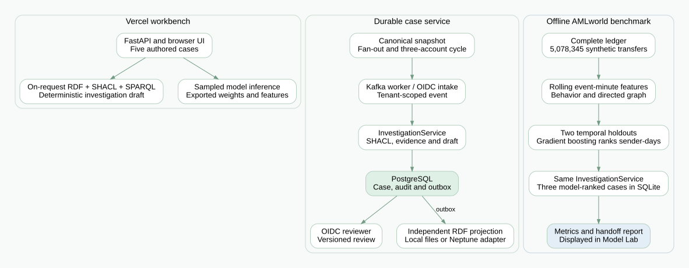

# FinGraph

Ontology-driven financial crime investigations with a working data pipeline, analyst review, and a reproducible graph ML experiment.

[Live workbench](https://fingraph-investigations.vercel.app) · [Research and architecture](docs/ARCHITECTURE.md) · [Model results](artifacts/evaluation.json) · [Verification](docs/VERIFICATION.md)

FinGraph connects transaction patterns, account holders, direct ownership assertions, and source evidence. Its five LangGraph stages produce a case draft for analyst review. This is a personal engineering and research project by Deepak Yadav, using synthetic data.



## Implemented

- Canonical ledger snapshot validation and bounded candidate generation.
- Kafka publisher and consumer with replay-safe intake, quarantine, and explicit offset commits.
- RDF/OWL vocabulary, SHACL validation, and SPARQL ownership retrieval.
- Five deterministic investigation stages and a resumable review gate.
- PostgreSQL-compatible case storage, idempotent reviews, version conflicts, transactional outbox, and an audit chain.
- OIDC JWT validation, role checks, tenant-scoped reads, and server-derived reviewer identity.
- SigV4 Neptune projection adapter and atomic local RDF export.
- Directed GraphSAGE, logistic regression, and gradient boosting trained on a public AML benchmark sample.
- Live model inference, research library, architecture report, and private-service controls in the workbench.
- GitHub Actions for code checks, a Kafka/PostgreSQL integration test, benchmark reproduction, and Vercel deployment.

## Run the workbench

Requires Python 3.12 or later.

```bash
python -m venv .venv
source .venv/bin/activate
pip install -r requirements-dev.txt
uvicorn api.index:app --host 0.0.0.0 --port 8000
```

Open `http://localhost:8000`. Investigations uses five authored cases. Model lab runs the exported model heads for selected held-out benchmark transactions. The public demo review is session-local. The Pipeline tab uses the authenticated durable service endpoints.

## Run the complete local service stack

Requires Docker with Compose.

```bash
docker compose up --build -d
docker compose run --rm worker python -m pipeline.cli publish
docker compose exec -T worker python -m scripts.verify_stack
```

This starts Kafka, PostgreSQL, the FastAPI service, and the worker. It publishes five source events, commits cases, exports RDF, and verifies a recorded review. Repeating the publication exercises idempotency. The single-node stack uses development credentials and localhost port bindings.

To build candidates from a canonical ledger snapshot and replay them locally,

```bash
mkdir -p var
python -m pipeline.candidates --input data/ledger_snapshot.json --output var/events.jsonl
export DATABASE_URL=sqlite:///var/fingraph.db
python -m pipeline.cli init-db
python -m pipeline.cli replay --file var/events.jsonl
```

Set `OIDC_ISSUER`, `OIDC_AUDIENCE`, and `OIDC_JWKS_URL` to enable the private API. Tokens require `sub`, `tenant_id`, `iat`, `exp`, and a `roles` array. Supported roles are `ingest`, `analyst`, and `reviewer`. Set `DATABASE_URL` to PostgreSQL for the durable service. Private routes reject requests when required configuration is absent. See [.env.example](.env.example).

## Train and reproduce

The official source is IBM AMLworld HI-Small, with 5,078,345 synthetic transactions. The checked-in experiment uses a label-blind 5% sample of 253,980 rows, including 267 positives. Sampling reduces graph coverage. The source CSV is downloaded separately and verified by checksum. [Dataset source and license](https://github.com/IBM/AML-Data)

```bash
pip install torch==2.15.0 --index-url https://download.pytorch.org/whl/cpu
pip install -r requirements-ml.txt
mkdir -p data/raw
curl --fail --location --retry 3 'https://www.kaggle.com/api/v1/datasets/download/ealtman2019/ibm-transactions-for-anti-money-laundering-aml/HI-Small_Trans.csv' -o data/raw/HI-Small_Trans.csv
python -m ml.prepare --input data/raw/HI-Small_Trans.csv
python -m ml.train --epochs 20
```

The benchmark workflow runs these steps and retains the exported artifacts. Training uses past-only graph snapshots with fixed temporal boundaries. Model and threshold selection use validation data. The held-out test contains 43,126 transactions and 74 positives.

| Model | Test average precision | Precision in top 1% | Recall in top 1% |
|---|---|---|---|
| Directed GraphSAGE | 0.0117 | 0.46% | 2.70% |
| Logistic regression | 0.0179 | 1.16% | 6.76% |
| Gradient boosting | 0.0900 | 6.71% | 39.19% |

Gradient boosting leads in this experiment. The scores are uncalibrated, and the experiment covers one synthetic source, one sample, and one seed. The data card and complete settings appear in [the architecture report](docs/ARCHITECTURE.md).

## Verify

```bash
ruff check api pipeline ml tests scripts/verify_stack.py
ruff format --check api pipeline ml tests scripts/verify_stack.py
python -m pytest -q --disable-warnings
node --check app.js
```

The regression suite covers ingestion identity, atomic rollback, process-restart review recovery, concurrent decisions, tenant access, signed JWTs, invalid records, projection retries, and model export parity. CI also runs the actual Kafka/PostgreSQL stack.

## Deployment

Vercel hosts the UI, synthetic investigation API, and exported model inference. The root configuration includes the Python function's ontology, fixtures, and model artifacts. Kafka workers, model training, and private Neptune connectivity belong in the backend environment.

The manual deployment workflow requires the GitHub secret `VERCEL_TOKEN` and repository variables `VERCEL_ORG_ID` and `VERCEL_PROJECT_ID`. The workflow validates code before publishing. No token is stored in this repository. Connecting the repository in Vercel also enables the platform's Git deployment workflow.

## Scope

The implementation provides an engineering reference with verified software behavior and a measured benchmark. Live sanctions screening, bank connectors, automated identity resolution, full OWL reasoning, legal beneficial-owner determination, and regulatory filing require further implementation. Production load, disaster recovery, penetration testing, and institutional model validation remain unverified.

The five specialists use deterministic functions and templates. The public app's authored scenarios use heuristic rules. The trained model comparison uses the external synthetic dataset. The report maps each component to its implementation and identifies further deployment work.

The dataset-derived inference examples retain IBM attribution and CDLA-Sharing-1.0 terms. See [data attribution](docs/DATA_LICENSE.md). Source code is provided without an additional software license declaration.
