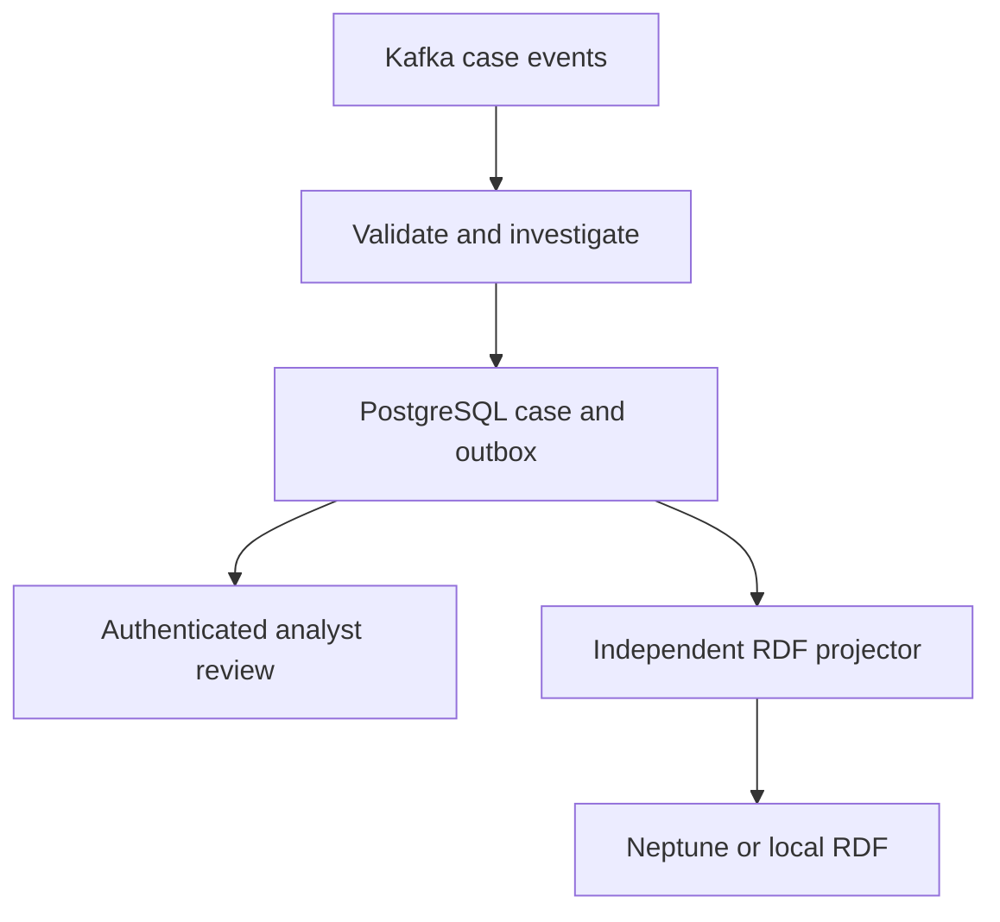

# FinGraph

FinGraph is a research workbench for investigating synthetic bank transactions. It links transfers, account holders and ownership records in RDF, validates the evidence with SHACL, and uses five LangGraph stages to prepare a draft for analyst review.

[Live app](https://fingraph-investigations.vercel.app/) · [Architecture](docs/ARCHITECTURE.md) · [Runbook](docs/RUNBOOK.md) · [CI](https://github.com/deepak2233/fingraph-investigations/actions/workflows/ci.yml)

## Try it

1. Open **Investigations → Rapid fan-out → Run investigation**. The rule finds four counterparties in 30 minutes. Select a transfer in the timeline to see its amount, source record, and RDF resource.
2. In **Data & RDF explorer**, remove an ownership evidence link and run SHACL. Inspect the failed constraint and its SPARQL results.
3. In **Model lab**, change the review budget or score a held-out transaction. Switch between the three explanations to see the input contributions and their limits.

The public app loads synthetic fixtures and model results from static assets. It uses live APIs for validation, investigation and scoring, with [labelled published examples](https://fingraph-investigations.vercel.app/?mode=published#investigation) available as a fallback.

## Architecture



Kafka offsets advance after the case or quarantine record commits. Replays use the same event identity. The projector reads committed outbox rows, so a slow graph store can delay RDF publication while intake continues. PostgreSQL stores the versioned review and audit trail. The ontology and model benchmark serve separate paths.

## Benchmark

All models use the same temporal holdout from a label-blind 5% sample of IBM AMLworld HI-Small. The test set has **43,126 transfers and 74 positives**. A 1% budget gives 432 reviews per model.

| Model | Test average precision | Positives found | False positives |
|---|---:|---:|---:|
| Directed GraphSAGE | 0.0117 | 2 / 74 | 430 |
| Logistic regression | 0.0179 | 5 / 74 | 427 |
| Histogram gradient boosting | **0.0900** | **29 / 74** | **403** |

Gradient boosting led on validation average precision and kept the lead on test. One synthetic split cannot establish bank performance. [Metrics and diagnostics](artifacts/evaluation.json) · [Data provenance](docs/DATA_LICENSE.md) · [Training commands](docs/RUNBOOK.md#reproduce-the-benchmark)

## Run locally

Use Python 3.12 for the webapp alone.

```bash
python -m venv .venv
source .venv/bin/activate
pip install -r requirements.txt
uvicorn api.index:app --host 127.0.0.1 --port 8000
```

For Kafka, PostgreSQL, graph projection, and durable review, use Docker Compose.

```bash
docker compose up --build -d
docker compose run --rm worker python -m pipeline.cli publish
docker compose exec -T worker python -m scripts.verify_stack
```

Open `http://localhost:8000`. The [runbook](docs/RUNBOOK.md) covers authentication, Neptune, replay and release verification. CI checks the Python and JavaScript code, regenerates the expected static demo outputs, verifies intake with projection offline, and tests projection recovery and event replay.

FinGraph is a personal research implementation. The public app uses synthetic data and browser-session review. Durable review requires the backend stack and configured authentication. Live institution data and Neptune connectivity remain unverified.
