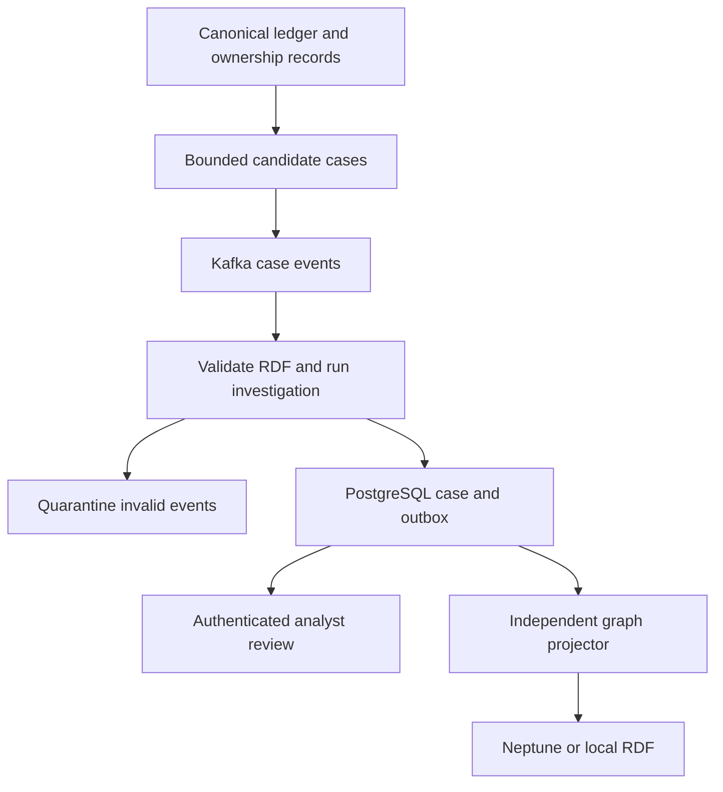

# FinGraph

FinGraph is an investigation workbench for anti-money laundering (AML) teams. Given a suspicious-activity alert and a bounded set of transactions, it connects accounts, holders, direct ownership assertions, and source records. The output is an evidence-linked case draft for an analyst to review.

[Live demo](https://fingraph-investigations.vercel.app/) · [Architecture](docs/ARCHITECTURE.md) · [Runbook](docs/RUNBOOK.md) · [CI](https://github.com/deepak2233/fingraph-investigations/actions/workflows/ci.yml)

This is a personal research project. The public demo uses synthetic data. The Docker stack demonstrates durable case storage and review. The public workbench has rule-based investigations and a separate inference lab. The rolling benchmark connects offline model ranking to the existing investigation service for synthetic account-day cases. [Production readiness review and pilot gates](docs/PRODUCTION_READINESS.md) · [Rolling benchmark](docs/ROLLING_BENCHMARK.md)

## Where it fits

An institution could place FinGraph between its existing alert source and its analyst queue. The analyst sees which transfers support the alert, how the parties are connected, and what still needs verification. A reviewer decides whether to accept the draft, reject it, or request more evidence.

| Use case | Who would use it | Input and analyst output |
|---|---|---|
| Transaction monitoring | Bank or payment-provider AML team | A ledger snapshot or upstream alert. Inspect rapid fan-out and chronological circular flows, with transaction IDs and event times. |
| Merchant or business onboarding | KYB analysts at a bank, acquirer, or fintech | Resolved business and registry records. See direct ownership assertions, their supporting records, and missing evidence. |
| Payments investigation | Wallet or remittance operations | A case assembled from payout activity. Trace the sequence of transfers and document items to check, such as legitimate settlement activity. |
| Case quality and audit | Review leads and internal assurance teams | A draft, its source references, and a reviewer rationale. Reconstruct the case and check its recorded decisions and versions. |

A practical first pilot is **read-only alert enrichment for one queue**. Connect approved ledger and registry feeds, map cases to the institution's case IDs, and compare the enriched drafts with the existing process. The screening stage demonstrates freshness and missing-data handling. Live screening and indirect ownership resolution require institution-approved sources and policies. [FATF context on AML technology](https://www.fatf-gafi.org/en/publications/digitaltransformation/documents/opportunities-challenges-new-technologies-for-aml-cft.html)

## Try a case

1. Open **Investigations → Rapid fan-out → Run investigation**. The synthetic account `A001` sends four transfers to four counterparties in 30 minutes. The rule flags the pattern and the draft waits for review.
2. Select **T003** in the timeline. The network highlights the transfer, the evidence panel shows USD 31,000 and source record `ledger-demo:3`, and the RDF link opens that same transaction resource.
3. In **Data & RDF explorer**, remove an ownership evidence link and run validation. Inspect the failed SHACL constraint and the change in the ownership query results.
4. In **Model lab**, score a held-out transaction. Switch between logistic contributions, tree model sensitivity, and GraphSAGE contributions. The [published examples](https://fingraph-investigations.vercel.app/?mode=published#investigation) also work when the live Python API is unavailable.

## How the pipeline works



| Step | What goes in and what comes out | Code |
|---|---|---|
| **1. Candidate generation** | A ledger snapshot supplies account IDs, amounts, currencies, event times, and source references. The builder identifies patterns inside a bounded time window and emits versioned `CaseEvent` records with deterministic IDs. | [Candidate builder](pipeline/candidates.py) |
| **2. Intake and validation** | The Kafka worker validates the event schema and maps the case into RDF/OWL. SHACL checks required relationships and field types. Invalid Kafka records go to durable quarantine. | [Worker](pipeline/worker.py) |
| **3. Investigation** | Five deterministic LangGraph stages check graph patterns, screening freshness, ownership, evidence, and drafting. SPARQL retrieves source-backed direct ownership. The draft lists observations, evidence IDs, and unresolved questions. | [Workflow](api/core.py) |
| **4. Persistence and replay** | PostgreSQL commits the case, audit record, and RDF outbox together. The worker commits the Kafka offset after the case or quarantine commits. Replaying an identical event returns its existing case. | [SQL store](pipeline/store.py) |
| **5. Projection and review** | A separate projector writes RDF while the analyst accesses the saved case through FastAPI. OIDC authenticates the reviewer, and a version check prevents conflicting reviews. Projection can recover from its backlog without blocking intake. | [Projector](pipeline/projector.py) · [API](api/index.py) |

The **public demo** runs bounded scenario, validation, and scoring APIs on Vercel. Its review is session-only. Run the **Docker stack** for Kafka, PostgreSQL, and the independent projector. Neptune transport is tested against a mock endpoint. Local integration writes N-Triples files. [Architecture and API contracts](docs/ARCHITECTURE.md) · [Configuration](.env.example)

## Model benchmark

Authored fixtures power the investigations. The separate ML experiment trains on a **label-blind 5% sample** of IBM AMLworld HI-Small with 253,980 transactions. It uses chronological train, validation, and test windows. Graph features come from history before the evaluated window. The model scores in the lab are separate from rule-based case findings. [IBM dataset](https://github.com/IBM/AML-Data) · [Dataset attribution](docs/DATA_LICENSE.md)

The holdout contains **43,126 transfers and 74 labelled positives**. All models get the same 1% review budget of **432 transactions**.

| Model | Test average precision | Positives found | False positives | Positives missed |
|---|---:|---:|---:|---:|
| Directed GraphSAGE | 0.0117 | 2 | 430 | 72 |
| Logistic regression | 0.0179 | 5 | 427 | 69 |
| Histogram gradient boosting | **0.0900** | **29** | **403** | **45** |

Gradient boosting led on validation average precision and retained the lead on test. Accuracy alone would hide the workload. An always-negative model gets 99.83% accuracy while finding zero positives. The 5% sample removes graph connections, and the experiment uses one synthetic holdout. A full-graph comparison over several time windows is needed before recommending a model for a bank. [Full metrics](artifacts/evaluation.json) · [Reproduce training](docs/RUNBOOK.md#reproduce-the-benchmark)

In a follow-up experiment, restoring full pre-cutoff history for the tree model's degree features raised test average precision from 0.0900 to 0.1090, with the same labelled targets and review budget. Positives found rose from 29 to 30 out of the top 432. The review documents the measured coverage, remaining investigation gaps, and case-level tests needed for a pilot. [History ablation](docs/PRODUCTION_READINESS.md#experiment-on-full-historical-context)

The rolling benchmark processes **all 5,078,345 transfers**. At a budget of 100 sender-day groups, adding graph features to the behavior model raised positive groups found from 70 to 90 and from 67 to 87 across two temporal holdouts. The three model-selected preview cases passed validation and retained their source references after replay. [Results and run command](docs/ROLLING_BENCHMARK.md) · [Benchmark JSON](artifacts/rolling_benchmark.json)

The explanations answer different questions. The investigation timeline shows the exact transfers used by a rule. Logistic terms reconstruct the model logit. The tree view replaces one feature group and shows how the score changes. GraphSAGE separates contributions from sender, receiver, and transaction inputs to its fitted scorer. Attribution to individual historical transfers remains open.

## Business value and revenue model

**For an institution, the pilot should measure review capacity and evidence quality.** Compare matched cases with and without the enrichment. Track median review time, evidence completeness, and the number of relevant cases found within a fixed review budget. Check that faster reviews do not increase missed cases or unsupported findings.

**Illustrative capacity calculation.** If a pilot verified 10 minutes saved across 1,200 cases per month, that would free 200 analyst-hours per month. At a loaded analyst cost of ₹1,000/hour, the capacity is worth ₹2 lakh per month or ₹24 lakh per year before software, integration, and operating costs. This estimates capacity. Realised cash savings depend on how the institution uses that time.

**Illustrative revenue model.** The buyer would be a bank or fintech compliance team. A private deployment could use an annual platform subscription plus a one-time integration fee. For one hypothetical customer, ₹12 lakh per year plus ₹3 lakh for integration gives **₹15 lakh first-year contract value** and **₹12 lakh in annual subscription value** if renewed at the same price. These are example inputs. The project has no commercial pricing, customer revenue, or measured savings to report.

## Run locally

Clone the repository and use Python 3.12 for the workbench. The shipped artifacts support inference without retraining or an external model API key.

```bash
git clone https://github.com/deepak2233/fingraph-investigations.git
cd fingraph-investigations
python3.12 -m venv .venv
source .venv/bin/activate
python -m pip install -r requirements.txt
python -m uvicorn api.index:app --host 127.0.0.1 --port 8000
```

On Windows PowerShell, create the environment with `py -3.12 -m venv .venv` and run `.\.venv\Scripts\Activate.ps1`. Open [localhost:8000](http://127.0.0.1:8000/) for the workbench or [/docs](http://127.0.0.1:8000/docs) for the FastAPI schema. In a second terminal, try the public investigation endpoint.

```bash
curl --fail --silent --show-error http://127.0.0.1:8000/api/investigate \
  -H 'Content-Type: application/json' \
  -d '{"case_id":"FG-001"}'
```

The response includes `status: awaiting_analyst_review`, the fan-out evidence, and a draft. To start from an input ledger snapshot, run the [candidate generation and replay example](docs/RUNBOOK.md#replay-a-ledger-snapshot-without-kafka).

## Run the tests

**Regression and artifact checks** run from the repository root in the activated environment. Node.js is needed for the syntax checks.

```bash
python -m pip install -r requirements-dev.txt
python -m pytest -q
python -m scripts.export_workbench --check
node --check app.js
node --check lab.js
node --test tests/workbench.test.cjs
```

The tests cover data validation, Kafka quarantine handling, durable replay, concurrent reviews, model prediction parity, and score explanations. The artifact check catches drift between the live implementation and published examples.

With the local workbench running, smoke test the public APIs, including graph validation, investigation, and model scoring.

```bash
python -m scripts.smoke_public http://127.0.0.1:8000
```

**Kafka/PostgreSQL integration** requires Docker Compose. Stop the standalone workbench first if it is using port 8000. On a fresh demo database, the verifier expects five cases, five projections, and one idempotent review.

```bash
docker compose up --build -d
docker compose run --rm worker python -m pipeline.cli publish
docker compose exec -T worker python -m scripts.verify_stack --check-offsets
```

GitHub Actions also starts intake with projection offline, checks that cases commit, starts the projector, checks the files, and waits for Kafka offsets after replay. [CI runs](https://github.com/deepak2233/fingraph-investigations/actions/workflows/ci.yml) · [Recovery drill and private setup](docs/RUNBOOK.md)
