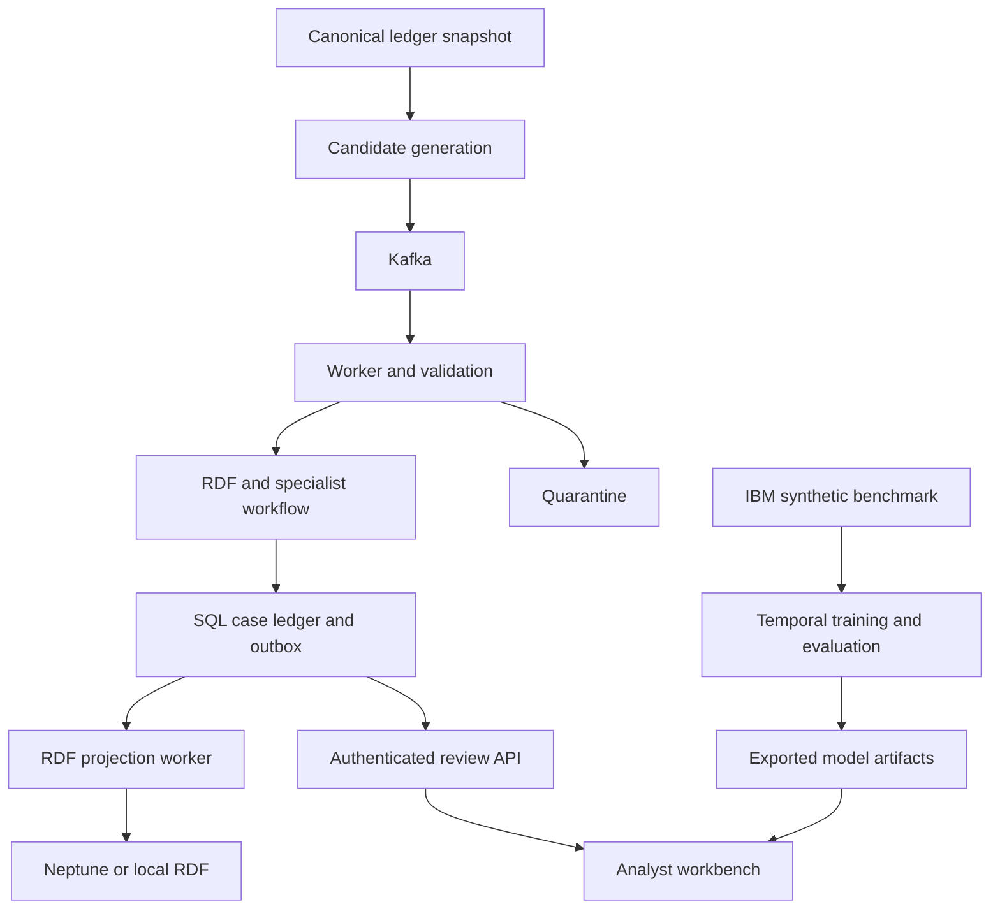

# FinGraph

**An inspectable financial-crime investigation system: source records → validated knowledge graph → evidence-linked findings → analyst review.**

[Live application](https://fingraph-investigations.vercel.app/) · [Detailed architecture](docs/ARCHITECTURE.md) · [Research report](https://fingraph-investigations.vercel.app/docs/FinGraph_Research_and_Architecture.html) · [Measured results](artifacts/evaluation.json) · [Verification record](docs/VERIFICATION.md)

FinGraph is a personal engineering and research project by Deepak Yadav. It demonstrates semantic data modelling, a replay-safe event pipeline, bounded specialist workflows and an independently evaluated graph-learning experiment. All supplied data is synthetic. It is not a bank deployment, a regulatory filing product or a certified compliance system.

## 1. Problem, users and intended outcome

A transaction alert rarely contains enough evidence to resolve an investigation. An analyst must connect transfers with account holders, ownership assertions, source records and screening context. A flat transaction score does not explain which entity or document supports a conclusion.

FinGraph gives the analyst an inspectable path from a source record to a draft finding. Data engineering supplies canonical identifiers. A worker validates the evidence and assembles the investigation. An analyst checks economic purpose and missing information. An authenticated reviewer records a decision. Compliance policy owners remain responsible for the escalation policy.

The engineering acceptance criteria are concrete:

- Replaying an event must not create a second case. Reusing its identity with different content must fail.
- Invalid source contracts or RDF graphs must not enter the investigation workflow.
- Each draft finding must resolve to source evidence. Unknown ownership and unavailable screening must remain explicit gaps.
- A stored review must survive process restart, require the correct tenant and role, and reject stale concurrent decisions.
- The ML comparison must preserve temporal boundaries, compare a GNN against tabular baselines, and report false positives and missed positives at the same review budget.

These are software and experimental objectives. Reduced analyst time, fewer missed real cases, loss prevention and institutional compliance have not been measured.

## 2. Explore the application

The app contains working inspection controls, not screenshots of an intended system.

Open the [public production URL](https://fingraph-investigations.vercel.app/) to start. The landing page and published catalog are static, so the workbench can display the fixtures, ontology and benchmark without waiting for the Python function. Investigation, graph validation and scoring buttons call the live API by default. If an eligible request times out or the API is unavailable, the corresponding response from the release is shown with a **Published example** label. The [published examples mode](https://fingraph-investigations.vercel.app/?mode=published#data) loads those reference results directly. The private review API always requires its configured service and identity provider.

| View | Exercise | What to inspect |
|---|---|---|
| Goal & scope | Read the problem, acceptance criteria and priorities | What is running, what is planned, and what remains unverified |
| Data & RDF explorer | Choose a scenario, build the graph, select a resource | Raw transactions, registry fields, JSON, exact triples, one-hop resource graph and complete Turtle |
| Data & RDF explorer | Remove a sender, make an amount negative or remove supporting evidence | The live pySHACL focus node, failed property and constraint message |
| Data & RDF explorer | Select an ownership or transaction SPARQL template | The actual query and results from the generated graph |
| Ontology & validation | Compare the method, vocabulary and shapes | Why each concept exists and how source fields become typed relationships |
| Investigations | Run a scenario and click a rule finding | Highlighted source transfers, five-stage trace, evidence references, data gaps and reviewable draft |
| Model lab | Change the review budget and inspect each model | PR/ROC curves, confusion counts, reliability bins and false-positive workload |
| Model lab | Score a held-out transaction | Live scores, exact logistic terms, tree-model sensitivity and the boundary of GNN explanation |
| Pipeline | Supply a configured OIDC session on your service deployment | Durable ingestion, reload and versioned review |
| Architecture / Research | Open the HLD and filter papers | Component responsibilities, 26 paper records, design implications and reading-depth limits |

### Worked exercise: rapid fan-out

1. Open **Investigations → Rapid fan-out**. Inspect the transfer network and run the workflow.
2. The configured rule detects at least four distinct recipients in a rolling 60-minute window. It assigns 40 demonstration prioritisation points. Click the finding to highlight the exact supporting transaction IDs.
3. Inspect the evidence register. A finding must reference records that exist. Treasury settlement and supplier payments are alternative explanations that need investigation.
4. Open **Data & RDF explorer** for the same scenario. Inspect `ex:A001`, its `fg:heldBy` relationship, the holder entity, ownership assertion and supporting registry evidence.
5. Choose **Remove one ownership evidence link** and rebuild. SHACL rejects the temporary graph because the assertion lacks required support. The displayed source JSON remains unchanged. This is a validation exercise, not a write to a bank system.
6. Restore the original graph and run the direct-ownership query. Shared direct assertions are context; they do not establish legal beneficial ownership or illicit conduct.
7. Record a demonstration review in the public workbench or use the authenticated service API for durable review. The two storage modes are visibly distinguished.

## 3. Architecture and responsibility boundaries




| Component | Implemented responsibility | Important boundary |
|---|---|---|
| Canonical contract | Typed account/transaction records, Decimal amounts, timezone checks, reference integrity and limits | Source-specific bank extraction and entity resolution are external |
| Candidate builder | Bounded ledger window and explicit temporal motifs | This is not a full streaming feature store |
| Kafka intake | Manual offset commit after SQL commit or durable quarantine | At-least-once transport; no cross-system exactly-once claim |
| RDF/OWL + SHACL | Vocabulary, graph construction and structural validation | Full OWL DL reasoning and legal UBO inference are not enabled |
| LangGraph | Five deterministic specialist steps and an interrupt for review | No LLM provider is called; no free-form autonomous tool execution |
| SQL store | Idempotency, case snapshot, versioned review, audit hash chain and outbox | Privileged SQL rewrites require an external audit trust anchor to detect |
| Projection adapter | Retryable, idempotent named-graph insertion signed with AWS SigV4 | Live Neptune connectivity has not been exercised |
| ML experiment | Reproducible supervised training and exported inference | Separate from rule-driven scenario decisions |
| Vercel | Public UI, bounded Python investigation requests and model-head inference | Kafka consumers and model training run in a separate backend environment |

### Five specialists

| Stage | Inputs | Output and explanation |
|---|---|---|
| Graph risk | Timestamped transfers | Four-recipient fan-out within 60 minutes; first chronological three-account same-currency cycle within 24 hours; exact supporting transfer IDs |
| Screening | Authored screening-availability fixture | Freshness/availability gap; no live list, sanctions clearance or candidate-match claim |
| Ownership | RDF account, holder, assertion and evidence nodes | SPARQL direct-owner rows, shared asserted owners and missing ownership |
| Evidence | Source transaction IDs and ownership source records | Evidence register used by the draft |
| Case drafting | Signals, ownership and evidence | Deterministic cited findings, gaps and next steps; pauses for human review |

The SQL store persists the complete pre-review workflow snapshot. Review reconstructs that snapshot and resumes the LangGraph gate. Intermediate specialist execution is pure and may rerun after a failure. This is not a claim that every intermediate LangGraph step has a database-backed checkpoint.

## 4. Data: two distinct uses

| Data | Origin | Used for | Not used for |
|---|---|---|---|
| Five investigation scenarios | Authored synthetic records in `data/cases.json` | Semantic mapping, rule explanations, screening gaps and review exercises | Training or claiming model accuracy |
| Canonical ledger example | Authored `data/ledger_snapshot.json` | Candidate-generation CLI | A connector to a bank transaction system |
| IBM AMLworld HI-Small | Official IBM synthetic AML dataset | Temporal supervised benchmark | Real customer data or adjudicated criminal findings |
| Inference cards | Selected held-out IBM sample rows with attribution | Inspecting live model-head calculations | Estimating dataset-wide performance from the displayed cards |

The IBM source contains **5,078,345 transactions and 5,177 synthetic positives**. A label-blind Bernoulli sample with probability 0.05 and seed 42 produces **253,980 rows and 267 positives**. Removing 95% of transfers changes neighbourhoods and motifs. The results apply to this sampled graph.

Source: [IBM AML-Data](https://github.com/IBM/AML-Data), [official Kaggle distribution](https://www.kaggle.com/datasets/ealtman2019/ibm-transactions-for-anti-money-laundering-aml). Source SHA-256:

```text
b19d39f515523373f991b689c07e11e7b0b95c17a2c27a87d91584ae16c5b040
```

The importer verifies the exact CSV, preserves source-row references, sorts by timestamp and source row, and writes a manifest. The original source has no explicit timezone or delayed-arrival field; the parser's UTC convention does not establish the original business timezone. See [data attribution and license](docs/DATA_LICENSE.md).

## 5. Why an ontology, and how it is prepared

The ontology is a reviewed vocabulary and relationship model. It is not generated by the trained classifier. Begin with competency questions: who sent a transfer, who holds the sending account, which source supports a direct owner assertion, and what evidence is missing?

### Modelling choices

| Concept | Reason for separating it | Example |
|---|---|---|
| Account | An account is not its legal holder | `ex:A001 a fg:Account` |
| Party | Common superclass for people and entities | `fg:Person rdfs:subClassOf fg:Party` |
| LegalEntity / Person | A company and a natural person have different semantics | `ex:E001`, `ex:P001` |
| Transaction | A transfer has an identity, values, time and provenance | A resource connected by `fg:sender` and `fg:receiver` |
| OwnershipAssertion | A percentage and its evidence belong to a specific claim | `ex:ownership-A001` |
| Evidence | Supporting material is distinct from the claim | `ex:registry-A001` with source ID and observation time |

Case, RiskSignal and ScreeningCandidate are also declared in the vocabulary. They are not currently materialised as RDF instances; case workflow state is stored in JSON/SQL. FIBO alignment is proposed, not implemented or certified.

### Source-to-graph mapping

| Source field | RDF representation | Contract/shape requirement |
|---|---|---|
| Account `id` | Account IRI | Unique canonical ID |
| `holder` | `Account → heldBy → LegalEntity` | Exactly one holder |
| Transaction `id` | Transaction IRI | Unique source transaction ID |
| `sender`, `receiver` | Resource links to Accounts | Exactly one of each, existing account reference |
| `amount` | `fg:amount` typed `xsd:decimal` | Finite and greater than zero |
| `currency` | `fg:currency` string | Three uppercase letters; not a live ISO currency registry check |
| `timestamp` | `fg:occurredAt` typed `xsd:dateTime` | Explicit timezone in the JSON contract; no future observation relative to snapshot |
| `source_id` | `fg:sourceId` | Exactly one source reference |
| `owner`, `owner_percentage` | OwnershipAssertion with owner, entity and percentage | 0–100 and source fields required when an owner is supplied |
| `ownership_source`, `ownership_observed_at` | Evidence node source and timestamp | Required by the JSON ownership contract |

Illustrative assertion using the fixture's explicit source fields:

```turtle
ex:A001 a fg:Account ; fg:heldBy ex:E001 .
ex:E001 a fg:LegalEntity, fg:Party .
ex:P001 a fg:Person, fg:Party .
ex:ownership-A001 a fg:OwnershipAssertion ;
  fg:ownedEntity ex:E001 ; fg:owner ex:P001 ;
  fg:percentage "60"^^xsd:decimal ;
  fg:supportedBy ex:registry-A001 .
ex:registry-A001 a fg:Evidence ;
  fg:sourceId "synthetic-registry-v1:A001" ;
  fg:occurredAt "2026-11-01T00:00:00Z"^^xsd:dateTime .
```

The ontology preparation process is: define questions, separate concepts, choose stable IRIs, map source fields, write positive and negative SHACL cases, verify SPARQL answers, and review/version changes. In a deployment, use an institution-controlled namespace and an explicit identity-resolution policy.

OWL supplies semantic vocabulary; SHACL checks graph constraints; SPARQL retrieves relationships. OWL domain/range declarations are not substitutes for input validation. FinGraph uses RDFLib and pySHACL with RDFS closure, not a full OWL DL reasoner. Missing facts remain unknown. The current snapshot model does not resolve conflicting assertions, validity intervals, indirect ownership or jurisdiction-specific control tests.

Primary standards: [OWL 2 Primer](https://www.w3.org/TR/owl2-primer/), [SHACL](https://www.w3.org/TR/shacl/), [SPARQL 1.1](https://www.w3.org/TR/sparql11-query/).

## 6. Models, training and leakage controls

### Temporal splits

| Partition | Target timestamps | Graph history | Rows | Positives |
|---|---|---|---:|---:|
| Warmup | Before 4 September 2022 | Supplies initial history | 103,525 | 51 |
| Train | 4–7 September 2022 | Strictly before 4 September | 82,989 | 110 |
| Validation | 8 September 2022 | Strictly before 8 September | 24,340 | 32 |
| Test | 9 September onward | Strictly before 9 September | 43,126 | 74 |

All timestamps are parsed under the documented UTC convention. Equal-time transfers stay in the same partition. Target-period edges do not enter their period's graph. Historical labels are not used as node features. Account IDs index nodes but are not learned identity embeddings. Scaler and categorical vocabulary are fit on training targets only; unknown categories have explicit features.

The experiment uses a frozen graph per period, not sequential graph updates within a period. This avoids target-edge leakage but differs from a production event-time feature system.

### Features and models

Transaction fields: `log1p(amount paid)`, self-transfer, same-bank indicator, currency change, same-currency log received/paid difference, payment currency and payment format. Endpoint fields: log incoming/outgoing historical counts and indicators that incoming/outgoing history exists.

| Model | Training configuration | What it can represent |
|---|---|---|
| Directed GraphSAGE | Two layers, hidden size 16, incoming/outgoing mean aggregation, 32-unit edge head; Adam 0.003; weight decay 0.0001; square-root class imbalance weight; clip gradient norm 5; 20 epochs | Directed neighbourhood context plus transaction features |
| Logistic regression | Balanced class weights; maximum 300 iterations; seed 42 | Linear log-odds combination of the tabular features |
| Histogram gradient boosting | 100 iterations; 15 leaves; learning rate 0.08; L2 1; balanced weights; early stopping disabled; seed 42 | Nonlinear splits and feature interactions |

The GNN edge head concatenates sender embedding, receiver embedding and transaction features. Both baselines receive the same transaction fields and past-only endpoint activity features, without neighbour aggregation. GraphSAGE checkpoint **epoch 12** is selected by validation average precision. Model family selection uses validation AP; each fixed decision threshold maximises validation F1. The test set is not used for tuning.

### What is active in the app

All three models have trained weights and live server-side inference. The public UI selects curated held-out records. Python recomputes the prediction heads from JSON weights, while GNN node embeddings are frozen from the historical test snapshot. It does not train a model on each request or update embeddings for arbitrary new accounts.

Gradient boosting is labelled the benchmark leader because it wins on validation AP. It does not control the rule-based investigation scenarios. The ontology has not been shown to improve classifier performance in this experiment.

## 7. Evaluation: results and actual workload

| Model | Validation AP | Test AP | Test ROC AUC | Precision at top 1% | Recall at top 1% |
|---|---:|---:|---:|---:|---:|
| Directed GraphSAGE | 0.0133 | 0.0117 | 0.8466 | 0.46% | 2.70% |
| Logistic regression | 0.0115 | 0.0179 | 0.9407 | 1.16% | 6.76% |
| Gradient boosting | 0.0674 | 0.0900 | 0.9608 | 6.71% | 39.19% |

**Accuracy is the wrong primary objective here.** There are only 74 positive test rows among 43,126. Always predicting negative produces **99.83% accuracy and zero recall**. The app therefore emphasises average precision, precision/recall at review budgets, threshold-specific errors and score reliability.

At a 1% budget, every model gets 432 reviews. Gradient boosting finds 29 positives, with **403 false positives and 45 missed positives**. GraphSAGE finds 2; logistic regression finds 5. This is a retrospective top-k policy, not an online alert-volume guarantee.

At gradient boosting's validation-selected fixed threshold of approximately 0.966359, the test confusion counts are 13 true positives, 50 false positives, 61 false negatives and 43,002 true negatives. This is a different operating point from the 1% review budget. The UI exposes both policies.

The application provides:

- PR step curves retain every recall change and plateau endpoint. ROC retains every true-positive-rate change and plateau endpoint. The displayed areas reproduce average precision and ROC AUC; all held-out predictions contribute.
- Budget controls for 0.1%, 0.5%, 1%, 2%, 5% and 10%, with exact reviewed/found/missed counts.
- Per-model confusion matrices at validation-selected thresholds.
- Reliability bins comparing mean score with observed positive frequency. No calibration fit is claimed.
- Training loss and validation AP for every epoch.
- Validation-only feature-group permutation diagnostics, three repeats per group.

### Why gradient boosting performs best, and what is still a hypothesis

The measured result is that gradient boosting leads on validation AP (0.0674) and test AP (0.0900). On validation, jointly shuffling payment format reduces its AP by about 0.0634, amount by 0.0504 and payment currency by 0.0344, averaged over three repeats. These fields are important to this fitted model under this perturbation. Trees can express nonlinear interactions among them.

That does **not** establish the cause of the performance gap. The 5% sample removes neighbours and motifs; training contains only 110 positives; the GNN uses a small fixed architecture and frozen snapshots. These are plausible explanations for its weaker result, not demonstrated causal findings. Retraining on full neighbourhoods, multiple seeds, matched tuning budgets and graph/no-graph ablations is required to isolate the reason.

Only one synthetic dataset, sample, seed and temporal holdout were evaluated. There are no confidence intervals or external-bank results. No claim of production accuracy or analyst productivity follows from this benchmark.

## 8. Explainability: what each view actually explains

| Layer | Available explanation | Limitation |
|---|---|---|
| Source lineage | Transaction/source IDs, assertion source and timestamps | Does not prove source truth |
| Semantic graph | Typed nodes, named relationships, exact triples and queries | No legal ownership determination or full OWL deduction |
| Rule finding | Exact temporal condition and highlighted supporting transfer IDs | Describes the configured rule, not a learned model |
| Logistic model | Exact intercept plus feature × weight terms reconstructing the logit | Model association, not causality |
| Gradient boosting | Live rescoring after replacing one group with values from the first training row | Artificial substitution may be unrealistic; differences are not additive, causal or SHAP values |
| Global model reliance | Validation AP drop under grouped permutation | Correlated groups can share information; 32 validation positives make estimates unstable |
| GraphSAGE | Architecture, historical cutoff and input representation | Faithful per-edge model attribution has not been implemented |

A highlighted transaction path must not be presented as a GNN explanation. The app makes this distinction explicit.

## 9. Run locally

Python 3.12 or later:

```bash
python -m venv .venv
source .venv/bin/activate
pip install -r requirements-dev.txt
uvicorn api.index:app --host 0.0.0.0 --port 8000
```

Open `http://localhost:8000`. No external model API key is needed. The public review demonstration is browser-session only; the authenticated service endpoints use persistent SQL storage.

### Complete local service stack

Requires Docker with Compose:

```bash
docker compose up --build -d
docker compose run --rm worker python -m pipeline.cli publish
docker compose exec -T worker python -m scripts.verify_stack
```

This starts Kafka, PostgreSQL, the API and worker, publishes five events, commits cases, projects RDF and verifies a durable review. Restart and replay:

```bash
docker compose restart worker
docker compose run --rm worker python -m pipeline.cli publish
docker compose exec -T worker python -m scripts.verify_stack
```

The single-node stack uses development credentials and localhost port bindings. It is for a reproducible integration exercise.

### Candidate generation and local replay

```bash
mkdir -p var
python -m pipeline.candidates --input data/ledger_snapshot.json --output var/events.jsonl
export DATABASE_URL=sqlite:///var/fingraph.db
python -m pipeline.cli init-db
python -m pipeline.cli replay --file var/events.jsonl
```

`CaseEvent` carries schema version, event ID, tenant ID, received-at timestamp and the canonical case. Review writes require a request ID and expected case version. See [contracts](pipeline/contracts.py), [candidate generation](pipeline/candidates.py) and [.env.example](.env.example).

### Authentication and Neptune

Set `OIDC_ISSUER`, `OIDC_AUDIENCE` and `OIDC_JWKS_URL`. Tokens require signed RS256 claims `sub`, `tenant_id`, `iat`, `exp` and a `roles` array. Roles are `ingest`, `analyst` and `reviewer`. Reviewer identity comes from the validated token. Private endpoints fail closed when configuration is missing.

Set `DATABASE_URL` to PostgreSQL for durable services. The worker uses `KAFKA_BOOTSTRAP_SERVERS`, `KAFKA_TOPIC` and optional `KAFKA_CLIENT_CONFIG` for client settings. A production installation must configure TLS/SASL and an appropriate secrets mechanism.

`NEPTUNE_ENDPOINT` plus AWS credentials and region enables SigV4 projection through the worker. Otherwise `GRAPH_EXPORT_DIR` receives atomic local RDF files. The graph name is scoped by hashed tenant and run IDs. SQL and RDF projection are eventually consistent through the outbox; the SQL case is the review system of record. Neptune transport has been mock-tested, not verified against a live cluster.

## 10. Reproduce the model experiment

```bash
pip install torch==2.15.0 --index-url https://download.pytorch.org/whl/cpu
pip install -r requirements-ml.txt
mkdir -p data/raw
curl --fail --location --retry 3 \
  'https://www.kaggle.com/api/v1/datasets/download/ealtman2019/ibm-transactions-for-anti-money-laundering-aml/HI-Small_Trans.csv' \
  -o data/raw/HI-Small_Trans.csv
python -m ml.prepare --input data/raw/HI-Small_Trans.csv
python -m ml.train --epochs 20
```

Outputs in `artifacts/` include JSON model weights, curated inference examples and complete evaluation/diagnostic records. Raw and sampled CSVs are excluded from Git. Public model inference uses JSON arithmetic, not pickle deserialization or a PyTorch dependency. Export parity tests compare all checked-in examples with training-runtime predictions within `1e-6` absolute tolerance.

The manual benchmark workflow performs the same import and training process and uploads the artifacts. Dependency versions and runtime details are recorded. One-seed reproduction is not a substitute for model robustness evaluation.

## 11. API, tests and delivery pipeline

| Endpoint | Purpose | Access |
|---|---|---|
| `GET /api/cases` | Authored scenarios | Public synthetic data |
| `GET /api/ontology` | Actual vocabulary and SHACL shapes | Public |
| `GET /api/explorer/{case_id}` | RDF projection, mutations, validation and query result | Public allowlisted fixtures/templates |
| `POST /api/investigate` | Five-stage synthetic investigation | Public case ID only |
| `GET /api/model/examples` | Curated held-out examples | Public |
| `GET /api/model/evaluation` | Measured metrics and diagnostics | Public |
| `POST /api/model/score` | Recompute all three scores and explanations | Public example ID only |
| `POST /api/v1/events` | Durable ingestion | `ingest` role, matching tenant |
| `GET /api/v1/investigations` | List stored cases | `analyst` role |
| `GET /api/v1/investigations/{run_id}` | Reload case | `analyst` role, own tenant |
| `POST /api/v1/investigations/{run_id}/reviews` | Commit a review with expected version | `reviewer` role, own tenant |
| `GET /api/v1/investigations/{run_id}/audit` | Read audit trail | `analyst` role, own tenant |

The public graph explorer does not accept arbitrary SPARQL, external endpoints or user datasets. Invalid temporary graphs remain inspectable for teaching but cannot enter the investigation path. Request bodies are bounded at 2 MB, and canonical cases at 1,000 transfers / 500 accounts.

```bash
ruff check api pipeline ml tests scripts/verify_stack.py
ruff format --check api pipeline ml tests scripts/verify_stack.py
python -m pytest -q --disable-warnings
node --check app.js
node --check lab.js
```

CI runs lint, formatting, regression tests and JavaScript syntax checks. It also checks that the published demo files match the current fixtures, ontology, model artifacts and server outputs. Run `python -m scripts.export_workbench` after changing those inputs. A separate job runs actual Kafka/PostgreSQL containers, verifies ingestion/projection/review, restarts the worker and repeats publication to check replay. The suite covers rollback, duplicate identity conflicts, concurrent review conflicts, tenant isolation, JWT checks, quarantine, projection retries, RDF validation, explanations and model export parity.

Vercel hosts the public workbench. The manual deployment workflow validates code before deployment and requires `VERCEL_TOKEN` as a GitHub secret plus `VERCEL_ORG_ID` and `VERCEL_PROJECT_ID` variables. The final smoke check uses the public production origin, configurable with `PUBLIC_DEMO_URL`, and verifies the page, demo assets, graph validation, investigation and inference without credentials. See [verification](docs/VERIFICATION.md) for the observed CI and deployment state.

## 12. What the architecture achieves and the next work

The implementation demonstrates a reproducible investigation contract: source facts retain identity; malformed graphs fail validation; rules provide evidence IDs; human decisions are explicit; replay and review conflicts are handled transactionally. The trained comparison also demonstrates why a graph model must earn its place against a simpler baseline.

There is no measured claim that agents or an ontology improve AML classification, reduce analyst effort or satisfy an institution's controls. A personal reference implementation should not be described as an enterprise-validated banking deployment.

### P0 · Connect evidence safely

Add source-specific bank adapters, approved screening feeds, production OIDC and secrets management. Acceptance: contract tests against representative source samples, freshness checks, deny-by-default roles and verified provenance. Live sanctions checks must distinguish candidate matching from analyst resolution.

### P0 · Validate persistence at operational load

Add schema migrations, SQL tenant isolation controls, Kafka TLS/SASL, bounded worker concurrency, retry backoff, an operational DLQ and reconciliation. Acceptance: repeatable load tests at the institution’s stated event rate; crash recovery at each commit boundary; measured backlog, p95 latency, error rates and recovery objectives. Current single-broker CI proves a small functional flow only.

### P1 · Improve the model experiment

Train on a full graph or preserve complete temporal neighbourhoods; run multiple seeds and rolling holdouts; compare retrained graph/no-graph ablations and tune with equal budgets. Acceptance: report distributions and confidence intervals for average precision and recall at the same review budget. Promote a GNN only if that evidence beats the tabular baseline.

### P1 · Calibrate and challenge the decision policy

Fit calibration on a separate validation window, measure reliability and drift, and choose thresholds with an explicit review capacity and error-cost model. Acceptance: out-of-time calibration and stability checks, analyst review and a documented fallback to the previously approved model. No threshold should be chosen from this test set for deployment.

### P1 · Extend semantics and explanation

Add entity-resolution provenance, conflicting claims, validity intervals, multi-layer ownership and policy-specific control rules. Evaluate evidence coverage, explanation fidelity and missing-data behaviour. GNN edge explanations need a separate fidelity benchmark; a highlighted rule path cannot stand in for a learned model explanation.

### P2 · Validate the business outcome

Run a blinded analyst study or approved shadow deployment. Measure review time, useful-case yield, missed-case discovery, disagreement and escalation quality. Add disaster recovery, independent security testing, governance and retention controls. Operational benefit remains a target until measured with the intended users and data.

Additional operational work includes schema migrations, dependency/security scanning, immutable audit anchoring, backup/restore drills, data retention and deletion rules, rate limits, monitoring and alerting, institution-specific privacy controls and independent security review. Current tests verify small-scale software behaviour; throughput, p95 latency, recovery objectives and disaster resilience have not been benchmarked.

## 13. Research and attribution

The research register contains 26 foundational and AML papers. Each records a finding, design implication, limitation and reading depth. Full-text method review and abstract-level review are labelled separately; the count does not imply every paper received an exhaustive reproduction.

The implemented experiment is informed by [GraphSAGE](https://arxiv.org/abs/1706.02216) and the [AMLworld synthetic-data work](https://arxiv.org/abs/2306.16424). Other entries cover laundering motifs, temporal evaluation, knowledge graphs, GNN explanation, calibration and agent design. See [research.json](research.json) and the [detailed report](docs/ARCHITECTURE.md).

IBM-derived examples retain attribution and CDLA-Sharing-1.0 terms. See [DATA_LICENSE.md](docs/DATA_LICENSE.md). Authored fixtures are identified separately. No additional software-license declaration has been imposed on the repository.
