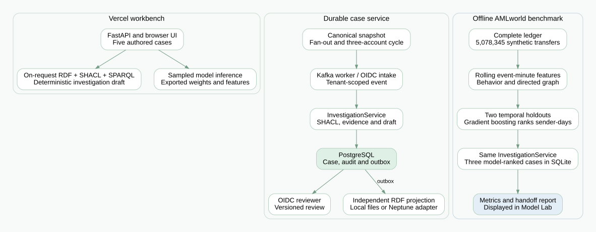

# FinGraph research and system architecture

Deepak Yadav · Personal engineering project · Version 0.2 · 18 November 2026

FinGraph turns a bounded transaction snapshot into an investigation with traceable observations, ownership evidence, and a recorded human review. The repository implements candidate generation, Kafka intake, semantic validation, a five-stage LangGraph workflow, durable SQL records, a retryable graph projection, three trained model baselines, and an inference workbench. The public Vercel app runs synthetic scenarios and benchmark inference. The private service stack runs with PostgreSQL, Kafka, and an OIDC provider.

## 1. The user and the decision

The intended user is an AML analyst at a bank or payment institution. An alert arrives because transaction behavior deserves review. The analyst needs to establish which records support the alert, whether account holders are connected, which observations remain uncertain, and what evidence should be requested next.

For example, Aster Trading sends four payments to separate counterparties within an hour. The graph-risk stage identifies the pattern. Ownership retrieval finds a shared direct owner assertion for two accounts. The evidence stage attaches the transaction IDs and registry references. The draft records the observed pattern and the open questions. An authenticated reviewer can record that the draft has been reviewed, reject it, or request further evidence. Investigation outcomes stay separate from the source ledger.

A production programme would measure analyst time, unsupported statements, evidence coverage, missed important information, and disagreement between reviewers. These outcomes require an analyst study. The current engineering verification measures software behavior and benchmark model predictions.

## 2. Architecture

| Component | Responsibility | Executable entry point |
|---|---|---|
| Candidate builder | Validate a canonical ledger snapshot, apply event-time bounds, build rule-triggered cases | `python -m pipeline.candidates` |
| Publisher | Publish versioned case events with an idempotent Kafka producer | `python -m pipeline.cli publish` |
| Intake worker | Consume events, validate contracts, run the investigation, commit SQL, acknowledge Kafka | `python -m pipeline.worker` |
| Semantic engine | Map records to RDF, validate shapes, retrieve direct ownership context | `api/core.py` |
| Investigation workflow | Graph risk, screening availability, ownership, evidence, drafting, review gate | `api/core.py` |
| SQL ledger | Event deduplication, cases, review requests, audit chain, projection outbox, quarantine | `pipeline/store.py` |
| Graph projector | Poll the committed outbox and write a deterministic tenant-specific graph | `python -m pipeline.projector` |
| Private API | OIDC authentication, roles, tenant scoping, versioned review | `api/index.py` |
| Model pipeline | Dataset preparation, temporal snapshots, training, evaluation, JSON exports | `ml/prepare.py`, `ml/train.py` |
| Workbench | Investigation view, model comparison, inference, authenticated service controls | `index.html`, `app.js` |

The semantic investigation and ML benchmark are two executable paths with different inputs. The five authored investigation cases exercise evidence handling. IBM AMLworld supplies model training and evaluation. Integrating a continuously refreshed bank feature store and trained score into the investigation policy is a subsequent institutional deployment decision.

## 3. Source contracts and candidate generation

A ledger connector supplies resolved account identifiers, account holders, transaction amounts, currency, timestamps with timezones, and source record IDs. Direct ownership assertions additionally require their percentage, source reference, and observation time. Decimal monetary values retain their precision during ingestion and RDF construction.

`InvestigationCase` rejects duplicate account or transaction identifiers, missing referenced accounts, future-dated transactions relative to the cutoff, missing source IDs, invalid monetary values, and ownership observations from after the cutoff. The current bounded contract accepts up to 500 accounts and 1,000 transactions. HTTP bodies are limited to 2 MB by counting streamed bytes.

The candidate builder applies a configurable lookback of 1 to 168 hours. Its default is 24 hours. It detects fan-out and chronological three-account cycles, preserves one-hop context around the triggering records, and constructs deterministic event IDs. The current cycle policy emits the first qualifying cycle within a bounded snapshot. Large-scale transaction monitoring needs partitioning and a candidate-recall study before adopting this detector.

Each case event carries a schema version, tenant ID, immutable event ID, received-at timestamp, and case payload. The Kafka key combines tenant and case identity. Canonical bank adapters, identity resolution, and cross-bank data-sharing arrangements remain specific to the source institution.

## 4. Ontology and graph integrity

| Concept | Representation | Interpretation |
|---|---|---|
| Account holder | `Account → heldBy → Party` | Resolved source account ownership |
| Transfer | `Transaction → sender / receiver → Account` | A distinct payment event with decimal amount and timestamp |
| Ownership assertion | Owner, owned entity, percentage, supported-by evidence | A source assertion requiring date and provenance |
| Evidence | Source identifier and observation timestamp | The record supporting an assertion |
| Risk signal | Rule output with transaction references | A reason to investigate |
| Investigation | Frozen input, output, version, review state | The unit of analyst work |

RDF identifiers preserve source relationships. OWL supplies the vocabulary and class semantics. SHACL verifies required properties and datatypes. SPARQL retrieves direct ownership records. The current implementation runs RDFS closure for validation. Full OWL DL reasoning and legal beneficial-owner determination require further components and rules. [W3C OWL 2](https://www.w3.org/TR/owl2-overview/), [SHACL](https://www.w3.org/TR/shacl/), [SPARQL](https://www.w3.org/TR/sparql11-query/)

FIBO provides a relevant financial vocabulary for a future mapping. FinGraph uses its own compact namespace so the actual scope can be inspected. Any FIBO mapping should have competency questions, versioned alignments, and reviewed equivalence statements. PROV-O supplies a standard foundation for richer entity, activity, and agent provenance. [FIBO](https://edmcouncil.org/frameworks/industry-models/fibo/), [PROV-O](https://www.w3.org/TR/prov-o/)

Indirect ownership needs more than multiplying percentages along arbitrary paths. Cross-holdings, multiple valid paths, share classes, changing control rights, and effective dates can change the interpretation. The executable scope retrieves direct source assertions. Missing assertions become explicit gaps. FATF guidance motivates reliable beneficial-ownership information, while local legal interpretation remains institution-specific. [FATF beneficial-ownership guidance](https://www.fatf-gafi.org/en/publications/Fatfrecommendations/Guidance-Beneficial-Ownership-Legal-Persons.html)

## 5. Five specialist contracts

| Stage | Input | Output | Failure or uncertainty |
|---|---|---|---|
| Graph risk | Valid bounded transaction graph | Fan-out and chronological same-currency cycle signals | A pattern requires economic context |
| Screening | Screening fixture status | Availability and freshness information | Live sanctions screening remains unconnected |
| Ownership | Typed account-holder graph | Direct assertions, shared-owner context, missing ownership | Source gaps stay visible |
| Evidence | Transactions and retrieved assertions | Referenced source register | Unresolved references prevent a valid draft |
| Drafting | Signals, evidence, source gaps | Deterministic narrative and investigation questions | Analyst review remains required |

The stages are deterministic LangGraph nodes. They have bounded inputs and explicit result contracts. A generative model would add a separate evaluation burden for unsupported claims, prompt injection, and source entailment. The current narrative comes from templates and validated source references. ReAct and RAG inform the research comparison but are research references for this version.

The graph-risk implementation groups transfers by sender and indexes possible cycle-closing edges by sender, receiver, and currency. Binary search enforces strict transaction chronology. Amounts in different currencies are not summed. Self-transfers cannot form a three-account cycle. Legitimate treasury, payroll, and aggregator behavior can resemble the configured patterns, so the draft preserves the need for contextual review.

## 6. Durability and concurrency

The SQL ledger uses six tables. `intake_events` records canonical payloads and their SHA-256 fingerprints. `investigations` stores the completed workflow snapshot and current review version. `review_requests` records idempotent review responses. `audit_events` stores a chained sequence of changes. `outbox` holds graph projections awaiting publication. `quarantine` retains malformed source events with their Kafka coordinates.

Event insertion, case creation, the first audit record, and the graph outbox entry share one SQL transaction. Repeating an event ID with identical content returns its existing case. Reusing that ID with different content yields a conflict. A database failure rolls back the entire transaction.

A review includes an expected version and request ID. The reviewer identity comes from the verified token. The SQL update checks both the prior version and the awaiting-review status. Concurrent requests produce one committed winner. An exact retry returns the already recorded response. Changed content under an old request ID produces a conflict.

The immutable pre-review LangGraph state is stored in the SQL case. After a process restart, the service reconstructs the review checkpoint from that snapshot, reaches the interrupt, and resumes with the authenticated decision. The SQL transaction owns the final review commit. Intermediate specialist steps are pure and may be recomputed before a completed snapshot is saved. This recovery model avoids external side effects inside the workflow stages. [LangGraph persistence](https://docs.langchain.com/oss/python/langgraph/persistence)

Audit records contain the preceding hash, case ID, version, actor, action, time, and rationale. A trusted external anchor or immutable archival destination is required to detect a privileged rewrite of the entire chain. The hash chain currently supports consistency checks within the application ledger.

## 7. Kafka and the transactional outbox

The consumer disables automatic commits and automatic offset storage. It commits an offset only after a case has been committed or the malformed record has been durably quarantined. Database failures leave the offset uncommitted. Replaying the event is safe because SQL enforces identity and payload consistency. [Confluent Python client](https://docs.confluent.io/kafka-clients/python/current/overview.html)

Kafka and PostgreSQL do not share a transaction. The implementation therefore uses at-least-once delivery with idempotent persistence. A crash after SQL commit and before offset commit causes a replay. A crash after graph publication and before the outbox is marked complete causes repeated graph insertion. The graph URI and triples are deterministic, so set insertion produces the same graph content.

The projector runs independently of the intake consumer. A slow or unavailable graph store leaves committed SQL cases available for review and the RDF jobs pending. The projector orders pending entries by attempt count and waits after an idle or failed poll. A late failure cannot reopen a published row. The current projector uses one process. Per-job backoff, dead-letter escalation, multi-worker leasing, and backlog alerts are follow-on work.

The Docker Compose stack is a local integration environment with one Kafka broker and one PostgreSQL instance. Production replication, backup, disaster recovery, topic ACLs, TLS, authentication, and capacity sizing depend on the target environment. Source producers must be trusted and authorized to publish each tenant's records.

## 8. Neptune projection

The adapter signs requests with AWS Signature Version 4 for the `neptune-db` service. It refreshes credentials through the AWS SDK provider chain. RDFLib serializes the triples, and hashed tenant and run identifiers construct the graph URI. User text is never interpolated into SPARQL syntax. The client uses an HTTPS endpoint, request timeouts, and disabled redirects. [AWS IAM authentication](https://docs.aws.amazon.com/neptune/latest/userguide/iam-auth-connecting.html)

Every case occupies a dedicated named graph. Queries in an institutional deployment must explicitly scope the graph and tenant. Neptune queries without graph scoping can consider the union of named graphs. The current investigation reads its validated in-memory case graph and asynchronously exports an archival RDF projection. Neptune-backed interactive retrieval requires integration testing against the actual VPC and IAM policy. [Neptune named graphs](https://docs.aws.amazon.com/neptune/latest/userguide/best-practices-sparql-query.html)

Local mode writes an atomic N-Triples file for each case. Adapter tests inspect the SigV4 request and graph scope. Live AWS provisioning and connectivity are outside the current verification record.

## 9. Authentication and API boundaries

Public routes accept only five configured investigation IDs and a fixed set of benchmark example IDs. Custom case content enters through `/api/v1/events`, which requires an OIDC token. The issuer, audience, JWKS endpoint, signature algorithm, expiry, issue time, subject, and tenant claims are validated. Roles are explicit lists containing `ingest`, `analyst`, or `reviewer` as applicable.

All read and review operations scope data using the tenant from the verified token. An ingestion tenant mismatch returns 403. Access to another tenant's case returns 404. The reviewer identity is never accepted from a form field. Tokens are kept in the browser session and are excluded from application logs.

| Route | Access | Purpose |
|---|---|---|
| `GET /api/health` | Public | Runtime and integration status |
| `GET /api/cases` | Public | Authored synthetic investigation cases |
| `POST /api/investigate` | Public fixed ID | Execute an investigation demonstration |
| `GET /api/model/evaluation` | Public | Dataset and measured model metrics |
| `POST /api/model/score` | Public fixed ID | Compute scores for a held-out example |
| `POST /api/v1/events` | Ingest role | Commit a validated investigation |
| `GET /api/v1/investigations/{id}` | Analyst role | Read a tenant-scoped saved case |
| `POST /api/v1/investigations/{id}/reviews` | Reviewer role | Record a versioned decision |
| `GET /api/v1/investigations/{id}/audit` | Analyst role | Inspect the recorded review history |

Private routes fail closed when authentication or database configuration is absent. Static file serving uses an allowlist. The Vercel configuration adds content-type, referrer, and content-security headers. Per-user rate limiting, enterprise identity integration, field redaction, key rotation procedures, retention enforcement, and a penetration test remain deployment work.

## 10. Data provenance and sampling

The model source is IBM AMLworld HI-Small, retrieved from the official Kaggle dataset endpoint linked by IBM. The source contains 5,078,345 transactions, including 5,177 synthetic laundering labels. Its SHA-256 is `b19d39f515523373f991b689c07e11e7b0b95c17a2c27a87d91584ae16c5b040`. The importer rejects a different checksum or schema. [IBM dataset repository](https://github.com/IBM/AML-Data)

A Bernoulli sample selects 5% of rows using seed 42 before using labels. It contains 253,980 transactions and 267 positive labels. This selection preserves an approximate natural class imbalance but removes transaction neighbors and can break motifs. Graph results therefore describe the sampled graph. The preparation command accepts a larger fraction for further experiments. The complete source CSV is excluded from the repository.

Account identifiers combine bank ID and account number. This avoids merging distinct accounts with identical local account numbers. The duplicate `Account` CSV headings are validated explicitly. Currency and payment-format vocabularies are fitted from the training period, and unseen values have an unknown category. Source timestamps lack an explicit zone, so benchmark ordering treats them as UTC.

IBM publishes the dataset under CDLA-Sharing-1.0, separately from the repository's software license. The exported inference examples contain a small derivative subset and retain the source attribution and sharing license. [Dataset license information](https://github.com/IBM/AML-Data/blob/main/README.md)

## 11. Temporal model experiment

| Partition | Transaction time | Graph visible to the model |
|---|---|---|
| Warmup | Before 4 September 2022 | Initial history only |
| Training | 4 to 7 September inclusive | History before 4 September |
| Validation | 8 September | History before 8 September |
| Test | 9 September onward | History before 9 September |

Equal-timestamp transactions stay together. A target-period edge is absent from that partition's graph. Validation and test features use prior transactions without their labels. The node universe is an indexing structure without learned ID embeddings. Unseen accounts have zero historical features. Standardization is fitted using training edges only.

The GraphSAGE comparator has two directed message-passing layers with separate incoming and outgoing aggregation and 16-dimensional hidden states. Initial node features describe historical incoming and outgoing counts and their availability. The edge head receives sender and receiver embeddings plus transaction features. Currency indicators accompany the log amount. A same-currency amount difference is computed only when the currency matches.

Training uses Adam with learning rate 0.003, weight decay 0.0001, gradient clipping at 5, and weighted binary cross-entropy. The positive weight is the square root of the negative-to-positive training ratio. Twenty epochs are evaluated on validation average precision. Epoch 12 is selected. The training set contains 82,989 transactions and 110 positives. The sampled node index contains 201,405 accounts.

Logistic regression and histogram gradient boosting receive the same transaction features plus historical sender and receiver degree features. Logistic regression uses balanced class weights. Gradient boosting uses 100 iterations, 15 maximum leaf nodes, learning rate 0.08, and L2 regularization of 1. Its internal random validation split is disabled. Each model's decision threshold is selected on validation F1. Held-out metrics are calculated afterward.

The JSON artifacts include model weights, thresholds, feature names, scaler values, dataset hashes, split boundaries, software versions, and measured metrics. The server computes logistic, tree, and GNN edge-head scores without loading pickle files. Tests compare the exported predictions with training-runtime reference predictions.

## 12. Measured results

The test partition contains 43,126 transactions, with 74 positives and a prevalence of 0.1716%. Values below come from the checked-in `artifacts/evaluation.json`.

| Model | Average precision | ROC AUC | Precision in top 1% | Recall in top 1% |
|---|---|---|---|---|
| Directed GraphSAGE | 0.0117 | 0.8466 | 0.46% | 2.70% |
| Logistic regression | 0.0179 | 0.9407 | 1.16% | 6.76% |
| Histogram gradient boosting | 0.0900 | 0.9608 | 6.71% | 39.19% |

Gradient boosting leads on validation average precision and on the recorded test comparison. The GNN underperforms both tabular baselines on test average precision. This result supports improving graph coverage, causal features, and evaluation before adding architectural complexity. The model scores remain uncalibrated. Brier scores and the validation-selected thresholds are available in the machine-readable report.

The result has substantial limits. It covers one sample, one seed, a small number of positives, and a single synthetic source. Confidence intervals, independent temporal windows, unsampled history, model calibration, cross-bank transfer, and operational analyst outcomes remain unmeasured. A high ROC AUC can coexist with a low proportion of relevant alerts under this class imbalance, so the UI reports review-budget precision and recall alongside it.

The inference cards deliberately include high-score examples, positive-label examples, and evenly spaced test examples. They illustrate behavior. Dataset-wide evaluation uses every row in the held-out partition. GNN embeddings on those cards were computed before the test cutoff, and the edge head runs on each API request.

## 13. Failure behavior

| Failure | Implemented response | Verification |
|---|---|---|
| Exact Kafka redelivery | Return existing committed case | Idempotency and integration checks |
| Changed payload under reused ID | Conflict | Regression test |
| Invalid account reference or time | Reject contract before workflow | Contract tests |
| Malformed Kafka event | Persist quarantine before offset acknowledgement | Worker boundary test |
| Database commit failure | Roll back event, case, audit, and outbox | Fault-injection test |
| Graph publication failure | Preserve pending projection for retry | Fault-injection test |
| Worker restart after SQL commit | Replay safely through event identity | Stack smoke test |
| Competing reviewer requests | One version update wins | Concurrent test |
| Review retry | Return saved response for identical request | Idempotency test |
| Expired or wrong-issuer JWT | Reject before business operation | Signed-token test |
| Other tenant requests a case | Return 404 | HTTP test |
| Model export changes numerics | Fail prediction-parity test | Inference artifact test |
| Live screening unavailable | Keep an explicit gap in the draft | Existing investigation test |

## 14. Deployment and CI

The Vercel deployment serves static assets and short FastAPI requests. Kafka consumption, a continuously available private graph connection, and model training run outside the request function. Connecting the Pipeline tab to the private API requires the service configuration in the [runbook](RUNBOOK.md). [FastAPI on Vercel](https://vercel.com/docs/frameworks/backend/fastapi)

The `CI` workflow checks code and regenerated demo assets. A separate job starts PostgreSQL, Kafka and intake with projection offline, then confirms five committed cases, pending outbox rows and broker acknowledgements. It starts the projector, checks the files and an idempotent review, and uses committed Kafka offsets to verify that the worker consumed the replay batch after a restart.

The benchmark workflow downloads the checksum-verified source, prepares the sample, trains all three models, and uploads the JSON artifacts. It runs on manual dispatch so ordinary code pushes avoid repeated dataset downloads. The deployment workflow reruns verification before using configured Vercel credentials. Its required GitHub secret and variables are documented explicitly. The current deployment can also be published through the connected Vercel account.

## 15. Operational acceptance before bank use

A bank deployment needs a named owner for source contracts, identity resolution, data retention, screening policy, model validation, incident response, and reviewer authorization. The workflow should be exercised against approved data with the actual tenant and identity configuration. Production targets for throughput, latency, recovery time, recovery point, and alert capacity need to be established with workload measurements.

Review objectives should include missing-evidence recall, false-positive workload, model drift by customer cohort and payment type, stale ownership and screening data, rejected-schema rate, Kafka lag, outbox delay, review conflicts, and audit completeness. Benchmark accuracy alone cannot establish operational suitability.

The most material extensions are full-history graph features, independent temporal evaluation, a live screening adapter with source-freshness controls, institution-approved ownership logic, persistent document evidence, and measured analyst evaluation. Those extensions should have explicit acceptance tests and a deployment-specific threat model.

## 16. Research register

The register covers 26 selected papers. Methods and experiment sections were inspected for AMLworld, Elliptic2, SynthAML, LaundroGraph, and collaborative AML. Other entries identify the abstract or primary-source description used. This is a targeted literature review with a separate FinGraph experiment. Published results are attributed to their own settings.

<!-- PAPER_REGISTER -->

## 17. Interactive exercise and interpretation

The expanded application provides the actual source tables, RDF instances, a navigable neighbourhood graph, allowlisted SPARQL results and live invalid-graph exercises. Its evaluation views are generated from the same stored artifact as the metrics below.

| Model | Validation AP | Test AP | Test ROC AUC | Precision at top 1% | Recall at top 1% |
|---|---:|---:|---:|---:|---:|
| Directed GraphSAGE | 0.0133 | 0.0117 | 0.8466 | 0.46% | 2.70% |
| Logistic regression | 0.0115 | 0.0179 | 0.9407 | 1.16% | 6.76% |
| Gradient boosting | 0.0674 | 0.0900 | 0.9608 | 6.71% | 39.19% |

### The problem and the user

A bank investigation analyst has an alert, transaction records, KYC identifiers and registry assertions. Those records live in separate systems. FinGraph assembles their relationships, checks whether the evidence is structurally complete, and prepares a reviewable account of what was observed. A pattern is an investigation lead, not a finding of crime.

### Goal and success criteria

The engineering goal is a reproducible path from source record to evidence-linked draft and recorded human decision. Success means replay does not duplicate cases, invalid records are quarantined, every finding resolves to evidence, tenant boundaries hold, and a review survives restart. The model goal is higher retrieval of labelled suspicious transactions within a fixed review budget. Analyst time saved, loss prevented and real-bank effectiveness have not been measured.

### Who does what

Data engineering supplies resolved account and party IDs. The worker validates and investigates. The analyst checks economic purpose and evidence. A reviewer records a decision with an authenticated identity. Compliance policy owners define thresholds and escalation rules. This application does not freeze accounts, decide guilt or file a regulatory report.

### What is active today

The public app executes RDF construction, SHACL validation, bounded SPARQL queries, five deterministic LangGraph steps and inference for three trained models. PostgreSQL/Kafka integration runs in GitHub CI and the local Docker stack. AWS Neptune is an implemented transport adapter tested with a mock endpoint. Live screening, bank feeds and a production identity provider are not connected.

### Why combine semantics and machine learning?

The ontology defines what a transfer, holder and ownership assertion mean. SHACL blocks malformed evidence. Rules explain specific temporal motifs. ML ranks examples by statistical patterns. SQL records workflow state and decisions. These responsibilities complement one another, but the current GNN benchmark is a separate experiment: no measured accuracy improvement from the ontology or agent workflow is claimed.

### A worked investigation

Open Rapid fan-out and run the workflow. Four recipients within 60 minutes create 40 prioritisation points. Click a finding to highlight its source transfers. Inspect A001 in Data & RDF, then follow heldBy to its legal entity and the ownership assertion to its source. Remove supportedBy in the validation exercise: the ownership claim fails SHACL. Restore the valid graph before investigation.

### 1. Start with competency questions

Which account sent each transfer? Who holds that account? Which source supports a direct ownership percentage? Are two active accounts linked to the same asserted owner? Is a critical field missing? These questions determine the vocabulary and queries. They are more useful design inputs than trying to model every financial concept at once.

### 2. Separate the things being described

An Account is not its holder. A LegalEntity is not a Person. A Transaction is an event with amount, currency, time and provenance, not just an unlabeled line. OwnershipAssertion is a separate record so percentage, subject entity and supporting evidence stay together. Evidence is distinct from the claim it supports.

### 3. Define stable identifiers and types

Canonical identifiers become ex: resources. The source account ID maps to ex:A001, holder ID to ex:E001 and owner ID to ex:P001. Person and LegalEntity are subclasses of Party. Object properties connect resources; datatype properties carry decimals, timestamps and strings. These examples use an illustrative namespace; a deployment needs an institution-controlled namespace and entity-resolution policy.

### 4. Map source fields explicitly

The graph builder maps sender and receiver to Account resources, amount to xsd:decimal, and timestamp to xsd:dateTime. Registry source and observation time become evidence attributes. An ownership assertion is materialised only when its required source fields exist. The missing-ownership scenario intentionally omits A001’s assertion. No absent owner is inferred from a name.

### 5. Validate before reasoning about risk

SHACL checks cardinality, class and datatype constraints. Transactions require exactly one sender, receiver, positive amount, currency, timestamp and source ID. Ownership assertions require an owner, legal entity, percentage between 0 and 100, and supporting Evidence. The JSON contract separately checks unique IDs, references and timestamps. Neither layer proves that the source record is true.

### 6. Query, review and version

Run the allowlisted SPARQL templates against the generated graph and compare answers with the source tables. Add regression cases for missing fields, changed types and conflicting claims. Review new terms with domain owners before changing the version. This repository supplies an OWL vocabulary, RDFS-assisted SHACL validation and explicit graph queries. It does not run full OWL DL reasoning or certify FIBO alignment.

### Why a separate ownership assertion?

A direct owner edge cannot carry multiple dated sources cleanly. A claim node preserves whose assertion it is, the entity it concerns, the percentage and supporting record. The current example is a snapshot with one assertion per account. Conflicting sources, validity intervals, indirect ownership chains and legal control rules still require a richer implementation.

### What the ontology does not do

OWL domain and range describe semantics; they are not substitutes for validation. Missing facts remain unknown. Shared direct ownership does not establish illicit conduct. A cycle in the transaction graph does not establish money laundering. RDF is used for meaning and provenance; the research GNN consumes numerical transaction graph features, not an OWL reasoning output.

### Source and sampling

IBM AMLworld HI-Small contains 5,078,345 synthetic transfers. The importer verifies the exact CSV checksum, samples each row with probability 0.05 using seed 42 without consulting labels, and sorts by timestamp and source row. The resulting 253,980 rows contain 267 positives. This removes neighbours and motifs, so results are for this sampled graph only. IBM’s labels are generated simulation labels, not adjudicated bank cases.

### Temporal protocol and leakage controls

History before 4 September 2022 supplies the training graph. Training targets span 4–7 September. Validation targets are 8 September with history strictly before that day. Test targets begin 9 September with history strictly before that day. Target-period edges are excluded from that period’s graph. Scaler and categorical vocabulary are fitted on training targets. Raw account IDs are graph indices, not learned identity features.

### Directed GraphSAGE

Two layers concatenate self, incoming-neighbour mean and outgoing-neighbour mean representations. Hidden size is 16. The edge head concatenates sender and receiver embeddings with transaction features, then uses a 32-unit ReLU layer and one logit. Adam trains 20 epochs at learning rate 0.003 with weight decay 0.0001, square-root imbalance weighting and gradient clipping at 5. Epoch 12 was selected by validation average precision.

### Tabular baselines and fair comparison

Logistic regression uses balanced class weights and up to 300 iterations. Histogram gradient boosting uses 100 iterations, 15 leaves, learning rate 0.08, L2 regularisation 1 and balanced weights. Both use the same transaction fields and past-only endpoint activity counts as the GNN, without neighbour aggregation. Hyperparameters are fixed; no test-set tuning is performed.

### Features and deployed inference

Transaction features encode log amount, self transfer, same bank, currency change, same-currency amount difference, payment currency and payment format. Endpoint features describe historical in/out counts and presence. The browser selects held-out examples; Python recomputes the three prediction heads from JSON weights. GNN embeddings are precomputed from the historical test snapshot. The public app does not train on demand or refresh embeddings for arbitrary new bank transactions.

### Why accuracy is misleading

Only 74 of 43,126 test rows are positive. A classifier that always predicts negative has 99.83% accuracy and finds zero positive cases. Select models using validation average precision, then report test average precision, precision and recall at a review budget, and a confusion matrix at a validation-selected threshold. Scores from class-weighted models are uncalibrated ranking values.

### Which model wins here?

Gradient boosting has the highest validation average precision (0.0674), so it is the benchmark leader before looking at the test result. On the test set its average precision is 0.0900, versus 0.0179 for logistic regression and 0.0117 for GraphSAGE. At a 1% review budget it finds 29 of 74 positive rows among 432 reviews. This leaves 403 false positives and 45 missed positives. It is the best of these three in this experiment, not a production-qualified detector.

### What evidence supports the explanation?

Validation-only grouped permutation tests measure the decrease in average precision when a feature group is shuffled. Gradient boosting relies strongly on payment format, amount and currency in this sample. Trees can represent nonlinear interactions among those fields. The permutation plot provides measured reliance, but does not prove those features cause laundering or prove why one algorithm outperforms another.

### Why the GNN may lag

Plausible causes include removal of 95% of transfers, loss of graph motifs, only 110 positive training targets, frozen graph snapshots and a small untuned architecture. These are hypotheses. A controlled full-graph experiment, retrained graph ablation, multiple seeds and matched tuning budgets are required to isolate the cause. More graph complexity is not automatically better.

### Evidence and model explanations

The transfer timeline and graph share a selection. Each selected transfer links to the source ID and RDF resource. Rule traces identify the condition that fired and the records it used. The Model lab separately shows exact logistic logit terms and gradient boosting sensitivity to feature-group replacement.

GraphSAGE uses frozen sender and receiver embeddings plus the transaction feature vector. For its exported linear–ReLU–linear scorer, each hidden preactivation varies linearly from the zero reference to the example. The fraction of this path above zero gives its exact integrated gradient. Sender, receiver and transaction contributions sum to the change in logit. This attributes the scorer inputs and leaves attribution to individual historical edges open. The reference is a mathematical baseline, outside the set of known transactions. [Integrated Gradients](https://proceedings.mlr.press/v70/sundararajan17a.html)

### Threshold versus review budget

A fixed threshold is selected by maximum validation F1 and carried unchanged into the test set. A top-k review budget instead sorts the whole held-out batch and reviews its highest scores. They are different operating policies. The budget explorer shows realised retrospective counts, not an online alert-volume guarantee.

### Uncertainty and operational impact

One seed, 32 validation positives and 74 test positives make the comparison fragile. No confidence interval, cross-bank evaluation, calibration fit, analyst-time study or cost-benefit trial has been completed. The graphs reveal the measured errors and limits rather than hiding them behind one accuracy percentage.

### P0 · Connect evidence safely

Add source-specific bank adapters, approved screening feeds, production OIDC and secrets management. Acceptance: contract tests against representative source samples, freshness checks, deny-by-default roles and verified provenance. Live sanctions checks must distinguish candidate matching from analyst resolution.

### P0 · Validate persistence at operational load

Add schema migrations, SQL tenant isolation controls, Kafka TLS/SASL, bounded worker concurrency, retry backoff, an operational DLQ and reconciliation. Acceptance: repeatable load tests at the institution’s stated event rate; crash recovery at each commit boundary; measured backlog, p95 latency, error rates and recovery objectives. Current single-broker CI proves a small functional flow only.

### P1 · Improve the model experiment

Train on a full graph or preserve complete temporal neighbourhoods; run multiple seeds and rolling holdouts; compare retrained graph/no-graph ablations and tune with equal budgets. Acceptance: report distributions and confidence intervals for average precision and recall at the same review budget. Promote a GNN only if that evidence beats the tabular baseline.

### P1 · Calibrate and challenge the decision policy

Fit calibration on a separate validation window, measure reliability and drift, and choose thresholds with an explicit review capacity and error-cost model. Acceptance: out-of-time calibration and stability checks, analyst review and a documented fallback to the previously approved model. No threshold should be chosen from this test set for deployment.

### P1 · Extend semantics and explanation

Add entity-resolution provenance, conflicting claims, validity intervals, multi-layer ownership and policy-specific control rules. Evaluate evidence coverage, explanation fidelity and missing-data behaviour. GNN edge explanations need a separate fidelity benchmark; a highlighted rule path cannot stand in for a learned model explanation.

### P2 · Validate the business outcome

Run a blinded analyst study or approved shadow deployment. Measure review time, useful-case yield, missed-case discovery, disagreement and escalation quality. Add disaster recovery, independent security testing, governance and retention controls. Operational benefit remains a target until measured with the intended users and data.

