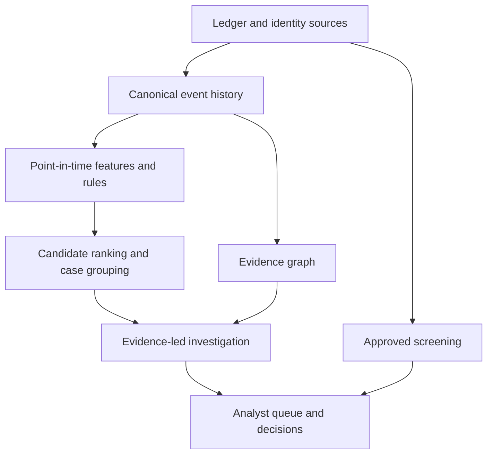

# FinGraph production readiness review

Audit of the FinGraph v0.4.2 implementation at commit `dfe0a61`, 20 November 2026.

**Decision. Keep live AML alert generation and case prioritisation with the institution's existing controls.** FinGraph can exercise a synthetic investigation and the database review workflow. It has yet to demonstrate detection coverage, analyst workload, or institutional control effectiveness. The first institutional evaluation should be read-only enrichment of alerts from one existing queue, with the access, evidence, and monitoring controls below in place.

The follow-up rolling benchmark measures full-history features across two holdouts and sends three model-ranked synthetic account-day groups through the investigation service. Release 0.4.4 publishes that comparison and adds a SHACL identity check so ambiguous resources fail new case intake. Cross-window case consolidation, new live motifs, and bank-grade validation are still open. The findings below describe the audited v0.4.2 implementation. [Rolling comparison and handoff](ROLLING_BENCHMARK.md) · [Current architecture and open requirements](ARCHITECTURE.md#16-operational-acceptance-before-bank-use)

## What the audited release did

The candidate builder reads a bounded ledger file and emits cases when a deterministic rule fires. The worker investigates and stores preassembled case events. The public model API scores a stored example by ID. These paths have independent inputs and outputs. No trained model is called by the candidate builder, Kafka worker, or investigator. An authenticated API, a graph projection, and replay tests establish engineering behaviour for those paths.

| Finding | Code or measured evidence | What must change |
|---|---|---|
| Detection and investigation are disconnected | [Candidate builder](../pipeline/candidates.py) calls `risk_signals`. [Intake](../pipeline/service.py) calls `investigate`. [Inference](../ml/inference.py) consumes benchmark examples with precomputed features. | Create an evaluated candidate ranking that emits a versioned case with score, eligibility, reason codes, and original evidence IDs. |
| Two motifs and limited context | [Rules](../api/core.py) look for four distinct recipients in 60 minutes and the first chronological, same-currency three-account cycle in 24 hours. A payroll fan-out and an unusual fan-out both satisfy the first rule. | Compare activity with account history, similar clients, reliable payment purpose, and validated counterparties. Test legitimate payroll and treasury settlements as explicit negative controls. |
| Replay deduplication has a narrow scope | The candidate fingerprint includes the snapshot cutoff. Re-running the same four transfers one minute later produced a different case ID. The SQL store deduplicates repeated events. | Give related activity a stable case key across overlapping windows. Record each changed evidence snapshot as a version under that case. Measure duplicate alerts and verify replay, late events, and concurrent updates. |
| Ownership evidence could cite the wrong registry source | Two accounts with the same legal holder made one evidence ID appear with both registry source IDs. A repeated claim could also make one active account look like several accounts in ownership summaries. | Fixed in this change. The SPARQL result carries the source and observation time of the bound evidence node. The register includes each registry reference once, and shared-owner results count distinct accounts. |
| RDF resource IDs can collide | A valid case with the same input ID for an account and transfer produced one RDF node with both types. SHACL passed in the reproduction. [Graph mapper](../api/core.py) uses a shared instance namespace. | Allocate canonical IDs by tenant, source, and entity type. Preserve the source ID as provenance. Version the graph mapping and plan migration and replay of existing graphs. |
| History and entity resolution are outside the intake contract | [Contracts](../pipeline/contracts.py) accept resolved IDs, one direct owner assertion per account record, event timestamps, and an investigation cutoff. The case contract caps input at 500 accounts and 1,000 transfers. | Build institution-approved source adapters and identity resolution. Track source arrival and effective dates, confidence, disputed matches, and versions. Keep ledger history outside the bounded investigation payload. |
| Screening is a simulation | [Screening step](../api/core.py) returns an authored empty or stale fixture. The workflow records a screening gap. | Integrate approved screening separately, using the institution's review rules for matches, stale data, and provider outages. The detector must have no path to suppress a required screening escalation. [FATF Recommendations](https://www.fatf-gafi.org/en/publications/Fatfrecommendations/Fatf-recommendations.html) |
| Evaluation stops at transactions | [Benchmark](../artifacts/evaluation.json) has time-based train, validation, and test partitions and synthetic transaction labels. There is no case-level evaluation against an incumbent alert queue. | Measure which distinct cases investigators find useful at a fixed review budget. Report missed known cases and estimate selection bias explicitly. |
| Operational evidence is limited to integration tests | Kafka/PostgreSQL exercises intake, replay, review, and recovery with a local RDF sink. The Neptune adapter has mock transport coverage. | Prove throughput, queue lag, tenant isolation, access, recovery and retention using the deployment environment and its actual data-volume envelope. |

The ownership fix changes new investigation output. Existing persisted results require a separate source reconciliation or a controlled re-investigation where shared holders were present.

## Experiment on full historical context

I reproduced the published histogram gradient boosting result, then repeated the fit with degree features computed from every transaction before each partition cutoff in the same verified HI-Small source. Both runs used the same 82,989 train, 24,340 validation and 43,126 test target rows. There were 110 labelled positives in training and 74 in test. The model settings, transaction fields, split boundaries, labels, and top-432 review budget were held fixed.

| Held-out metric | Sampled history | Full pre-cutoff history |
|---|---:|---:|
| Source transfers before the test cutoff | 210,854 | 4,214,445 |
| Test transfers with both accounts seen in history | 27,277 / 43,126 (63.2%) | 43,045 / 43,126 (99.8%) |
| Test transfers with neither account seen | 5,278 | 2 |
| Average precision | 0.0900 | 0.1090 |
| ROC AUC | 0.9608 | 0.9613 |
| Labelled positives in the top 432 | 29 | 30 |
| Labelled negatives in the top 432 | 403 | 402 |
| Labelled positives outside the top 432 | 45 | 44 |
| Precision at the review budget | 6.71% | 6.94% |
| Recall at the review budget | 39.19% | 40.54% |

The sample removed substantial account history. Restoring it improved average precision in this run and added one labelled positive at the chosen review budget. This ablation isolates historical coverage for the tree model's degree features. The later benchmark evaluates rolling replay and richer graph features. GraphSAGE with complete neighbourhoods remains open. Institutional tests need the records visible to the investigating institution at the decision time. [Machine-readable results](../artifacts/history_ablation.json) · [Experiment code](../ml/history_ablation.py) · [Rolling benchmark](ROLLING_BENCHMARK.md)

Run the experiment with the verified IBM source CSV and the published sample preparation settings. The program verifies both file digests and reads full-source history without labels.

```bash
python -m pip install -r requirements-ml.txt
python -m ml.prepare --input /path/to/HI-Small_Trans.csv --output data/processed --fraction 0.05
python -m ml.history_ablation --input /path/to/HI-Small_Trans.csv --data data/processed --output /tmp/fingraph-history-ablation.json
```

## What changes after reading the research

| Primary source | Result or method that matters | FinGraph design consequence |
|---|---|---|
| Altman et al., *AMLworld*, §3.2, §4 and Appendix D | The generator simulates eight graph-pattern families and preserves pattern and transaction labels for controlled benchmark work. Appendix D describes chronological feature extraction in batches. | Measure typology-specific candidate coverage. Keep complete available history even when sampling labelled prediction targets. Use a separate institutional validation for bank behaviour. [Paper](https://arxiv.org/pdf/2306.16424) |
| Blanuša et al., *Graph Feature Preprocessor*, §§3–4 | The authors add directed subgraph and account statistics to boosting models. On HI-Small, Table 4 reports minority-class F1 of 21.30% for basic LightGBM and 62.86% for GFP plus LightGBM with 128-row batches. The paper distinguishes streaming batches from offline settings that can expose future transactions. | Compare boosting with and without point-in-time graph features. Fix the decision time, including data that arrived at the same timestamp, before computing features. Published F1 is specific to the paper's split, features, and threshold. [Paper](https://arxiv.org/pdf/2402.08593) |
| Bellei et al., *Elliptic2*, §§2.2, 4–5 | They construct and classify bounded Bitcoin subgraphs. Background graph context improved ranking in their experiments. Their subgraph labels are defined by specific path and endpoint assumptions. | Use investigator-relevant connected activities as evaluation units. Keep the scope and provenance of labels explicit. Bitcoin subgraph labels and performance provide research evidence for that setting. [Paper](https://arxiv.org/html/2404.19109v3) |

## Proposed detection and investigation flow



1. **Source and identity.** Preserve original record IDs, tenant, source version, currency, event time, and the time a record became available. Reconcile KYC and registry identities with auditable links. Retain contradictory claims and record the evidence that supports each. Resolve uncertain identities through a separate review route.
2. **Point-in-time features.** Replay events in availability order and query only data visible at each score timestamp. Keep native currencies or use approved event-time conversions. Monitor source coverage and late events. Record the feature definition, value, and evidence used for a scored activity.
3. **Candidate generation and ranking.** Begin with the institution's incumbent alerts and a runnable rules-only baseline. Compare a tabular ranker with the same ranker plus behavioural and graph features. Separate the candidate-eligibility record from rank. Group transfers into cases and apply an analyst-capacity budget at that level.
4. **Investigation.** Retrieve source records from the evidence graph and use versioned, allowlisted queries. Show the activity, reference window, triggering records, identity confidence, and available alternative explanations. Keep deterministic drafting as the baseline. Evaluate language assistance for documents or drafting in a separate study against factual support and review effort.
5. **Outcome capture.** A reviewer records each decision, rationale, evidence consulted, and policy version. Track investigator disposition, confirmed findings, filings, unresolved cases, and synthetic labels separately. Use only outcomes that had matured by the training date.

Initial features should answer concrete questions. For example, beneficiary novelty measures how many destinations had no prior observed payment relationship in the lookback. A rapid pass-through measure compares eligible incoming and outgoing funds in the same currency and window, with a documented attribution policy. Same-owner exposure uses resolved, source-backed assertions eligible at the score time. Missing comparison history should yield an explicit availability flag. These features are candidates for validation.

## Acceptance gates

| Gate | Evidence required before moving forward |
|---|---|
| **1. Read-only enrichment of an existing queue** | Approved scope and sources, namespaced case and graph IDs, evidence lineage tests against shared holders and conflicting assertions, tenant access tests, and an agreed baseline for evidence coverage and analyst time. Keep the incumbent alerts and the institution's screening and review workflows in control. |
| **2. Shadow detection and ranking** | Repeatable chronological replay with feature availability and late corrections. Compare rules, tabular boosting, and the same model with graph features on identical dates and case budgets. Report candidate recall separately from recall after ranking and grouping. Evaluate known positives and independently reviewed samples both above and below the threshold. |
| **3. Controlled live release** | The institution sets go/no-go thresholds for case-level precision and recall, review load, unmet typology coverage, and investigator time before seeing holdout results. Show confidence intervals across windows and segments, traceable reasons and evidence, load and restore tests, alert and model monitoring, and a rollback drill using the incumbent queue. |

Use equal review capacity and candidate eligibility for ranker comparisons. Compare against what the existing queue actually found. Assign the same linked activity to one evaluation unit and assess repeated cases separately. Investigate what is missed at both stages. Test deliberate controls such as payroll bursts, recurring supplier payments, missing registry records and delayed events. Track hours per case, evidence completeness and unresolved assertions as well as classification metrics.

The institution needs to define the product and jurisdiction, available history and its latency, current alert workflow, how review outcomes are established, acceptable detection coverage, and analyst capacity. Those decisions determine pilot datasets, evaluation windows and release sign-off.
