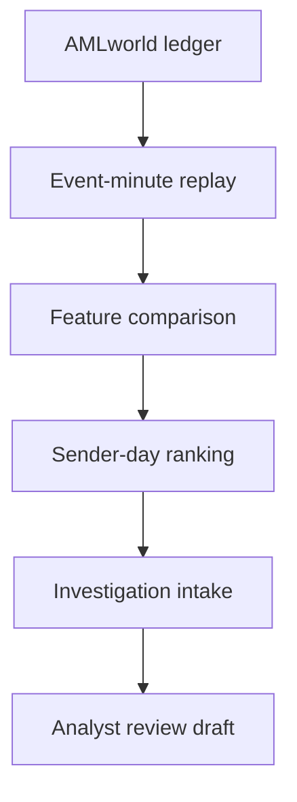

# Rolling AML detection benchmark

FinGraph replays all 5,078,345 transactions in the checksum-verified IBM AMLworld HI-Small file. It compares transaction features, recent account behavior and directed graph features on matched chronological splits. In the final test window, the three highest-ranked account-day groups from the validation-selected model enter FinGraph's existing investigation service in an isolated in-memory SQLite database.



## What a score can see

Account keys combine the bank and local account identifiers. Each transfer can use its own amount, currencies and payment format. Every transfer stamped at minute `t` reads historical state from minutes strictly before `t`. After the entire minute is scored, the graph receives those transfers. AMLworld has event timestamps. The experiment models records arriving in event-time order and treats the stated timestamps as UTC.

| Feature group | Computation |
|---|---|
| Transaction fields | Existing amount, currency, same-bank, self-transfer and payment-format features. Categories are fitted on training rows. |
| Rolling account behavior | Sender and receiver debit and credit counts over 24 hours. The sender's prior credit/debit ratio uses the outgoing payment currency and has a separate prior-debit indicator. |
| Recent inflow coverage | Prior credits in the payment currency over two hours divided by the current debit, capped at one. The value measures available recent inflow relative to that debit. Funds remain fungible and the feature does not attribute an outgoing payment to a specific credit. |
| Directed graph | Unique beneficiaries of the sender and unique origins of the receiver over 24 hours, prior count on the reverse edge, and whether the directed pair has appeared in any earlier minute. |

Windows include their lower boundary and exclude the scored minute. Historical self-transfers are excluded from account and edge state. Cross-currency history uses the amount paid on the debit side and the amount received on the credit side. No real customer sector, verified owner, payment purpose, sanctions, or record-availability fields are present. Those inputs, multi-hop cycle counts and tracing individual credits through cash flows are outside this benchmark.

## Comparison design

Every arm sees the same eligible rows within a split. Logistic regression and histogram gradient boosting first use the same transaction inputs. Two more boosting arms add account behavior, then the directed graph features. Boosting settings are shared with the original experiment. Preprocessing and model fitting use the train period. Validation account-day average precision selects the model used for the final investigation handoff.

| Fold | Train | Validation | Dense test |
|---|---|---|---|
| 1 | 3–5 September 2022 | 6 September | 7–8 September |
| 2 | 3–7 September 2022 | 8 September | 9–10 September |

1–2 September supplies history before training begins. The dense test windows do not overlap and share the same source simulator. They measure temporal variation across two windows. The 11–18 September tail contains 1,108 transactions and 480 sender-day groups. All 480 groups contain a positive label. It is reported separately, with case average precision left undefined.

A case is a bank-scoped sender and UTC day. Its score is the maximum of its transfer scores. Its reference label is positive if any outgoing transfer that day has a positive simulator label. The default budgets are 432 transfers and 100 sender-days per holdout, fixed across arms. The comparison ranks across each completed holdout. A prospective queue would need a per-period capacity and a scheduling policy.

The two case metrics are the number of positive sender-days within the review budget and average precision across the ranked list. This grouping measures a synthetic unit of review. A verified linked case may span several accounts and days. Bank outcomes and independently reviewed cases are needed to evaluate that unit. The earlier 5% sample and these full holdouts have different eligible populations, so their top-432 figures should not be compared as a controlled uplift.

## Held-out results

| Model | 7–8 September case AP | Positives in top 100 | 9–10 September case AP | Positives in top 100 |
|---|---:|---:|---:|---:|
| Logistic regression, transaction fields | 0.0151 | 4 | 0.0154 | 1 |
| Gradient boosting, transaction fields | 0.0438 | 9 | 0.0471 | 2 |
| Gradient boosting with account behavior | 0.2227 | 70 | 0.2021 | 67 |
| Gradient boosting with behavior and graph features | **0.3457** | **90** | **0.3451** | **87** |

Validation selected the graph-feature model in both folds. The matched boosting comparison attributes an additional 20 positive sender-days in each top-100 list to the graph feature group in this experiment. The first window contained 788 positive sender-days of 241,140 and the second contained 754 of 282,207. Case recall at the cap was 11.4% and 11.5%, with 698 and 667 positive groups missed.

At the transfer budget of 432, the graph-feature model retrieved 272 of 1,036 positives in the first window and 255 of 956 in the second. The corresponding transfer average precision was 0.3768 and 0.3564. Transaction-only boosting retrieved 35 positives at that budget in each window. [Full report](../artifacts/rolling_benchmark.json)

Scores serve as rankings. The estimators use class weights, and calibration was outside the comparison. Max-score grouping can favor accounts with more transfers. Two windows from one simulator leave open how the ranking behaves on a bank's narrower view of its own customers and its actual investigator decisions.

## Investigation handoff

The final fold applies the validation-selected model to the held-out window. The highest-scored transfer identifies each candidate's anchor. The handoff sends that transfer and up to 99 other same-day transfers, recording the full account-day size. It keeps the exact source row identifiers in the evidence register. Each account and its placeholder holder have separate ID prefixes. The input uses the debit-side amount and currency and does not infer beneficial ownership.

Each case passes through `InvestigationService`, RDF and SHACL validation, draft creation and the usual audit record. An identical event is replayed and checked against the saved investigation with exactly one creation audit record. The output remains awaiting analyst review. The synthetic labels are used to measure rankings and are excluded from the investigation input.

The three selected groups had 6, 6 and 9 transfers. All 21 transfers appeared in the evidence registers and all three drafts reached analyst review. The case IDs and anchor row references are in the report.

## Reproduce

```bash
python -m pip install -r requirements-ml.txt -r requirements.txt
OMP_NUM_THREADS=4 OPENBLAS_NUM_THREADS=4 python -m ml.rolling_benchmark \
  --input /path/to/HI-Small_Trans.csv --output /tmp/fingraph-rolling-benchmark.json
```

The report records the dataset hash, runtime versions, split boundaries, metrics and shadow handoff checks. The `Reproduce AML benchmark` workflow runs the same comparison after the original benchmark and publishes the aggregate JSON. Regression tests check same-minute leakage, window expiry and currency isolation. [IBM dataset and licence](https://github.com/IBM/AML-Data) · [AMLworld paper](https://arxiv.org/pdf/2306.16424) · [Graph feature methods](https://arxiv.org/pdf/2402.08593)
